# Thiết kế cơ sở dữ liệu (Database Design)

**Dự án:** E-Commerce Marketplace đa người bán tích hợp quản lý kho
**Hệ quản trị:** MySQL 8.0.16+ (bắt buộc từ 8.0.16 để `CHECK` có hiệu lực) · **Database:** `ECommerceWarehouse` · **Charset:** `utf8mb4` / `utf8mb4_unicode_ci`
**Script nguồn:** `database/scripts/01..06_*.sql` (nguồn sự thật duy nhất của schema; tài liệu này mô tả lại schema đó)

## Mục lục

1. [Tổng quan](#1-tổng-quan)
2. [Quy ước thiết kế](#2-quy-ước-thiết-kế)
3. [Nguyên tắc nghiệp vụ cốt lõi](#3-nguyên-tắc-nghiệp-vụ-cốt-lõi)
4. [Sơ đồ quan hệ (ERD)](#4-sơ-đồ-quan-hệ-erd)
5. [Máy trạng thái](#5-máy-trạng-thái)
6. [Từ điển dữ liệu](#6-từ-điển-dữ-liệu)
7. [Chỉ mục](#7-chỉ-mục)
8. [Trigger và View](#8-trigger-và-view)
9. [Ví dụ luồng dữ liệu end-to-end](#9-ví-dụ-luồng-dữ-liệu-end-to-end)
10. [Quy tắc phải do tầng ứng dụng bảo đảm](#10-quy-tắc-phải-do-tầng-ứng-dụng-bảo-đảm)
11. [Giới hạn đã biết và hướng mở rộng](#11-giới-hạn-đã-biết-và-hướng-mở-rộng)
12. [Cài đặt và kiểm tra](#12-cài-đặt-và-kiểm-tra)

---

## 1. Tổng quan

Cơ sở dữ liệu phục vụ **sàn thương mại điện tử đa người bán**: nhiều seller mở shop, khách đặt một đơn có thể chứa hàng của nhiều seller, mỗi seller (hoặc kho sàn) soạn và xuất phần hàng của mình. Phần quản lý kho theo dõi tồn kho theo từng **vị trí kệ**, giữ chỗ hàng cho đơn, ghi **sổ cái** mọi biến động tồn, và hỗ trợ nhập, xuất, điều chuyển, kiểm kê, nhận hàng trả.

Số liệu: **39 bảng**, **86 khóa ngoại**, **70 ràng buộc CHECK**, **32 chỉ mục phụ**, **13 trigger**, **2 view**, chia thành 6 phân hệ:

| # | Phân hệ | Bảng | Mô tả |
|---|---|---|---|
| 1 | Identity & Sellers | 6 | Tài khoản, phân quyền, người bán, gian hàng |
| 2 | Product Catalog | 4 | Danh mục, sản phẩm, biến thể (SKU), hình ảnh |
| 3 | Customer Interactions | 5 | Sổ địa chỉ, giỏ hàng, yêu thích |
| 4 | Orders & Payments | 6 | Đơn tổng, đơn theo seller, dòng hàng, lịch sử trạng thái, thanh toán, hoàn tiền |
| 5 | Warehouse & Inventory | 13 | Kho, vị trí, tồn kho, giữ chỗ, nhập/xuất/điều chuyển/kiểm kê, sổ cái tồn kho |
| 6 | Shipping, Returns & Reviews | 5 | Hãng vận chuyển, kiện hàng, trả hàng, đánh giá |

- **1. Identity & Sellers**: `Users`, `Roles`, `UserRoles`, `RefreshTokens`, `Sellers`, `Shops`
- **2. Product Catalog**: `Categories`, `Products`, `ProductVariants`, `ProductImages`
- **3. Customer Interactions**: `UserAddresses`, `Carts`, `CartItems`, `Wishlists`, `WishlistItems`
- **4. Orders & Payments**: `Orders`, `SellerOrders`, `OrderItems`, `OrderStatusHistory`, `Payments`, `Refunds`
- **5. Warehouse & Inventory**: `Warehouses`, `WarehouseLocations`, `Inventory`, `StockReservations`, `InventoryReceipts`, `ReceiptDetails`, `InventoryIssues`, `IssueDetails`, `StockTransfers`, `StockTransferDetails`, `StockCounts`, `StockCountDetails`, `StockMovements`
- **6. Shipping, Returns & Reviews**: `Carriers`, `Shipments`, `ReturnRequests`, `ReturnRequestItems`, `Reviews`

### Mô hình kho kép (đa seller)

| Loại kho | `WarehouseType` | Chứa hàng của | Ghi chú |
|---|---|---|---|
| Kho sàn | `Platform` | Nhiều seller | Seller gửi hàng vào (`SellerInbound`), sàn soạn và giao |
| Kho seller | `Seller` | Chính seller sở hữu (`OwnerSellerId`) | Seller tự soạn và giao |

Trigger `trg_Inventory_BI` ngăn hàng seller A nằm trong kho riêng của seller B; `trg_SellerOrders_BI/BU` ngăn đơn của seller A được xuất từ kho riêng của seller B.

---

## 2. Quy ước thiết kế

| Hạng mục | Quy ước |
|---|---|
| Đặt tên | Bảng và cột dùng `PascalCase`. Trên Linux MySQL **phân biệt hoa thường** tên bảng, nên viết đúng như trong script |
| Khóa chính | `BIGINT AUTO_INCREMENT` (riêng `Roles`, `Carriers` dùng `INT`); bảng nối dùng khóa kép |
| Tên ràng buộc | `PK_` khóa chính · `UQ_` duy nhất · `CK_` kiểm tra · `FK_` khóa ngoại · `IX_` chỉ mục · `FT_` fulltext · `trg_` trigger · `vw_` view |
| Thời gian | Lưu **UTC**, kiểu `DATETIME(3)`, mặc định `UTC_TIMESTAMP(3)`. `UpdatedAt` do ứng dụng (EF Core) gán vì MySQL không có `ON UPDATE` theo UTC |
| Tiền tệ | `DECIMAL(18,2)`; tỷ lệ hoa hồng `DECIMAL(5,2)` |
| Concurrency | `RowVersion TIMESTAMP(6) ... ON UPDATE CURRENT_TIMESTAMP(6)` ở `Orders`, `SellerOrders`, `Inventory`; cấu hình `.IsRowVersion()` trong EF Core (Pomelo) |
| Xóa | Xóa mềm bằng `IsActive` cho danh mục/tài khoản/kho. **Không xóa chứng từ** (FK mặc định `RESTRICT`). `CASCADE` chỉ dùng cho dữ liệu phụ thuộc hoàn toàn: `UserRoles`, `RefreshTokens`, `CartItems`, `WishlistItems` |
| Bản chụp (snapshot) | Đơn hàng lưu bản chụp tên, SKU, giá, địa chỉ giao để sửa danh mục/địa chỉ sau này không làm sai đơn cũ |
| Trạng thái | Cột `VARCHAR` + `CHECK ... IN (...)` thay cho `ENUM` để dễ đổi và dễ ánh xạ sang enum C# |
| Kiểm soát người thực hiện | Chứng từ có `CreatedBy`/`ApprovedBy`/`ConfirmedBy` và `CHECK` người duyệt khác người tạo |

---

## 3. Nguyên tắc nghiệp vụ cốt lõi

### 3.1 Công thức tồn kho

Mỗi dòng `Inventory` là tồn của một **(vị trí, biến thể)**:

```
Available = QuantityOnHand − QuantityReserved        (tính khi truy vấn, không lưu)
```

- `CK_Inventory_Qty` bảo đảm `0 ≤ Reserved ≤ OnHand`, nên **không thể âm** và không thể giữ quá tồn.
- Chỉ tính vào tồn **bán được** các vị trí có `IsSellable = 1` và `IsActive = 1` (view `vw_VariantAvailability`). Khu `Inbound`, `Returns`, `Damaged` luôn không bán được (`CK_Locations_Sellable`).

### 3.2 Giữ chỗ (reservation)

1. Khi đặt hàng, hệ thống **giữ chỗ trong cùng transaction** với tạo đơn: tăng `Inventory.QuantityReserved` và thêm dòng `StockReservations` (`Active`).
2. Câu lệnh giữ chỗ phải **nguyên tử**, không đọc rồi ghi:

```sql
UPDATE Inventory
SET    QuantityReserved = QuantityReserved + @q
WHERE  InventoryId = @id
  AND  QuantityOnHand - QuantityReserved >= @q;   -- kiểm tra ROW_COUNT() = 1, bằng 0 nghĩa là hết hàng
```

3. Kết thúc giữ chỗ theo 3 hướng: `Consumed` (xuất kho thật), `Released` (hủy đơn), `Expired` (job nền nhả khi quá `ExpiresAt`).
4. `Inventory.QuantityReserved` phải luôn bằng tổng `StockReservations` `Active` tại cùng (vị trí, biến thể); kiểm tra bằng view `vw_StockReconciliation`.

### 3.3 Sổ cái tồn kho (`StockMovements`)

- **Chỉ thêm, không sửa, không xóa**: trigger `trg_StockMovements_BU/BD` chặn. Muốn đính chính phải ghi bút toán đảo.
- Mỗi dòng ghi `OnHandChange` và `ReservedChange` tách riêng, cùng `OnHandAfter`/`ReservedAfter` (tồn sau biến động), chứng từ gốc (`ReferenceType` + `ReferenceId`) và người thực hiện.
- Bảng tóm tắt cách ghi từng loại biến động:

| `MovementType` | `OnHandChange` | `ReservedChange` | Khi nào |
|---|---|---|---|
| `Receipt` | +N | 0 | Xác nhận phiếu nhập (seller gửi hàng) |
| `ReturnIn` | +N | 0 | Nhận hàng khách trả |
| `TransferIn` | +N | 0 | Kho đích nhận hàng điều chuyển |
| `TransferOut` | −N | 0 | Kho nguồn xuất hàng điều chuyển |
| `Reserve` | 0 | +N | Giữ chỗ khi đặt hàng |
| `ReleaseReserve` | 0 | −N | Hủy đơn hoặc hết hạn thanh toán |
| `Issue` | −N | −N | Xuất kho cho đơn (tiêu thụ giữ chỗ) |
| `Issue` (tiêu hủy, trả seller) | −N | 0 | Xuất không qua giữ chỗ |
| `Adjustment` / `StockCount` | ±N | 0 | Điều chỉnh tay hoặc kết quả kiểm kê |

### 3.4 Đa seller

- Mỗi `Orders` (một lần checkout) tách thành nhiều `SellerOrders`, `UNIQUE(OrderId, SellerId)`.
- Seller của sản phẩm suy ra: `ProductVariants → Products → Shops → Sellers`. Trigger `trg_OrderItems_BI` bảo đảm dòng hàng thuộc đúng seller của đơn con.
- Thanh toán gắn **đơn tổng** (`Payments.OrderId`); hoàn tiền có thể gắn **đơn con** (`Refunds.SellerOrderId`).
- Hoa hồng: `Sellers.CommissionRate` lưu tỷ lệ; bảng đối soát/chi trả cho seller chưa thiết kế (xem mục 11).

### 3.5 Kiểm soát chứng từ kho

| Chứng từ | Người tạo | Người duyệt/xác nhận | Ràng buộc |
|---|---|---|---|
| `InventoryReceipts` | `CreatedBy` | `ConfirmedBy` | `CK_Receipts_Separation`: khác người tạo |
| `InventoryIssues` | `CreatedBy` | `ApprovedBy`, `DispatchedBy` | `CK_Issues_Separation`; loại Adjustment/ReturnToSeller/Disposal bắt buộc có người duyệt trước khi `Dispatched` |
| `StockTransfers` | `CreatedBy` | `ApprovedBy`, `ReceivedBy` | `CK_Transfer_Separation` |
| `StockCounts` | `CreatedBy` | `ApprovedBy` | `CK_StockCounts_Separation` |

Phiếu đã xác nhận không được hủy; muốn đảo phải tạo phiếu ngược chiều.

### 3.6 Hàng trả về

Hàng khách trả **không tự cộng vào tồn bán được**: nhận về → kiểm tra từng dòng (`ReturnRequestItems.InspectionResult`) → nhập vào kệ bán (`Good`), khu giảm giá (`MinorDefect`) hoặc khu hàng hỏng `Damaged`. Trigger `trg_ReturnRequests_BI` chỉ cho yêu cầu trả với đơn con `Delivered`; `trg_ReturnRequestItems_BI` chặn trả quá số đã mua.

---

## 4. Sơ đồ quan hệ (ERD)

Các sơ đồ dưới đây vẽ bằng Mermaid (GitHub hiển thị trực tiếp). Mỗi đường là một khóa ngoại, nhãn là tên cột. **Không vẽ** các khóa ngoại kiểm toán tới `Users` (`CreatedBy`, `ApprovedBy`, `ConfirmedBy`, `DispatchedBy`, `ReceivedBy`, `ReviewedBy`, `InspectedBy`, `ChangedBy`) cho gọn; xem chi tiết ở mục 6. Nhãn dạng `LocationId_WarehouseId` là **khóa ngoại kép**.

### 4.0 Tổng quan luồng chính

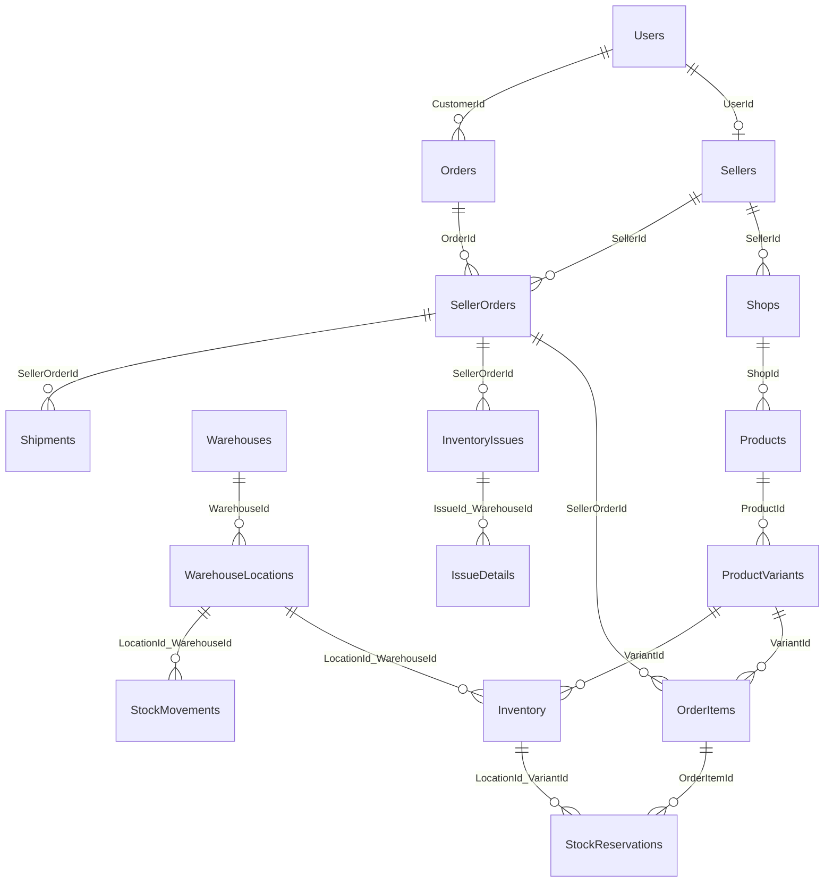

### 4.1 Identity & Sellers

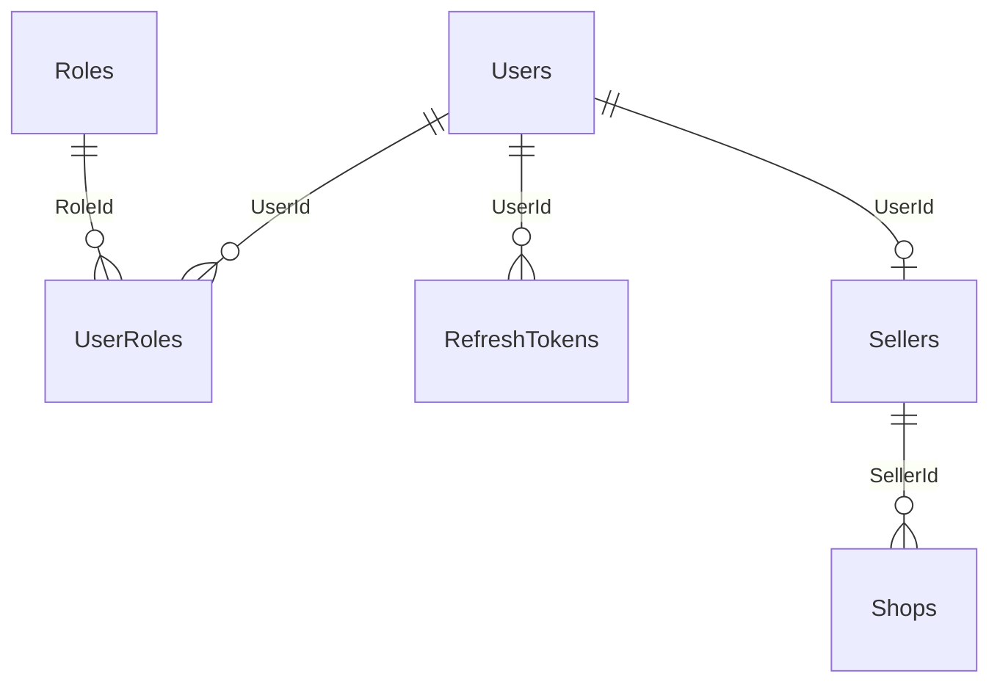

### 4.2 Product Catalog

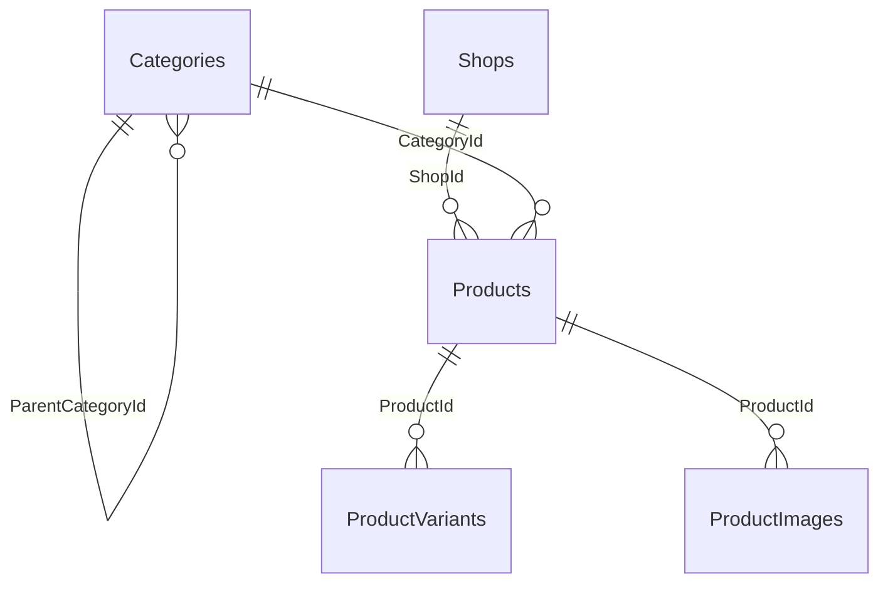

### 4.3 Customer Interactions

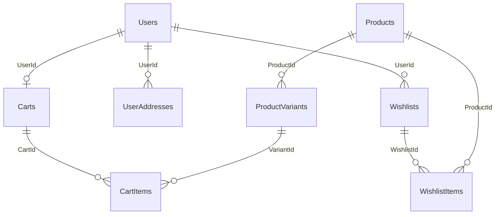

### 4.4 Orders & Payments

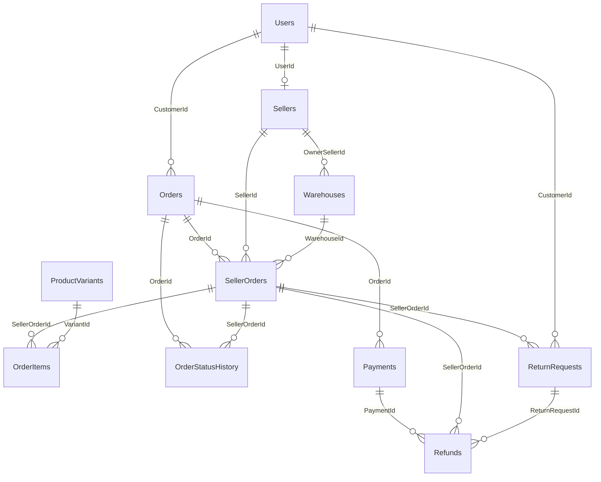

### 4.5 Kho, tồn kho, giữ chỗ và sổ cái

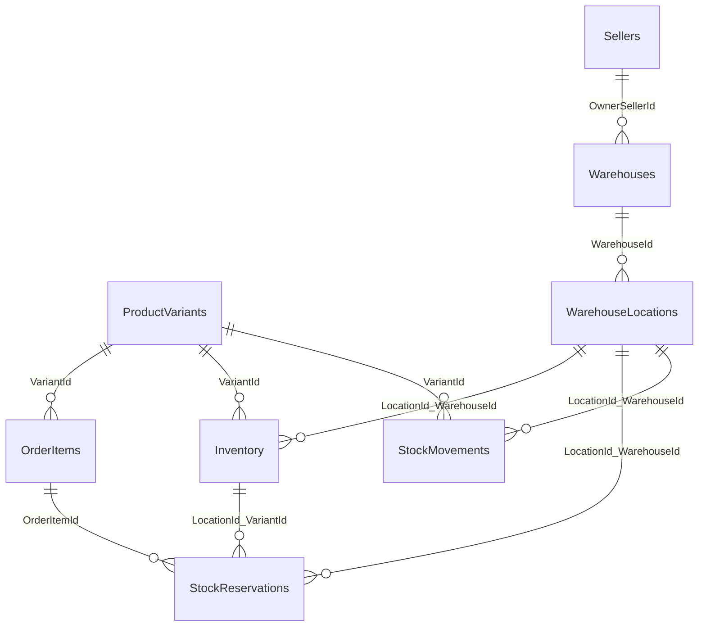

### 4.6 Chứng từ kho: nhập, xuất, điều chuyển, kiểm kê

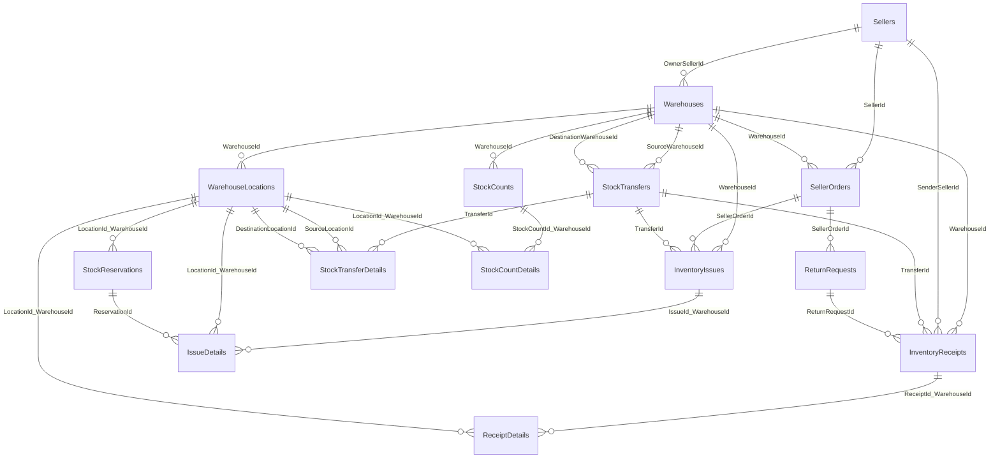

### 4.7 Vận chuyển, trả hàng, đánh giá

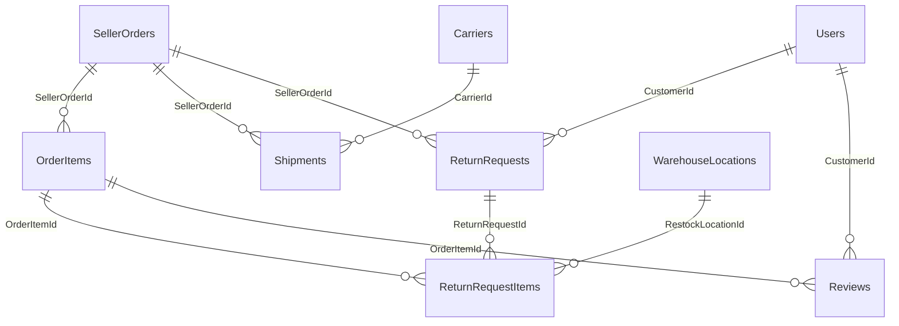

---

## 5. Máy trạng thái

Cơ sở dữ liệu chỉ **giới hạn tập giá trị hợp lệ** của cột trạng thái (bằng `CHECK`); **thứ tự chuyển trạng thái do tầng service kiểm tra** và ghi vào `OrderStatusHistory` (với đơn hàng). Chuyển sai thứ tự phải trả lỗi 409 `INVALID_STATUS_TRANSITION`.

### 5.1 Đơn tổng `Orders.OrderStatus`

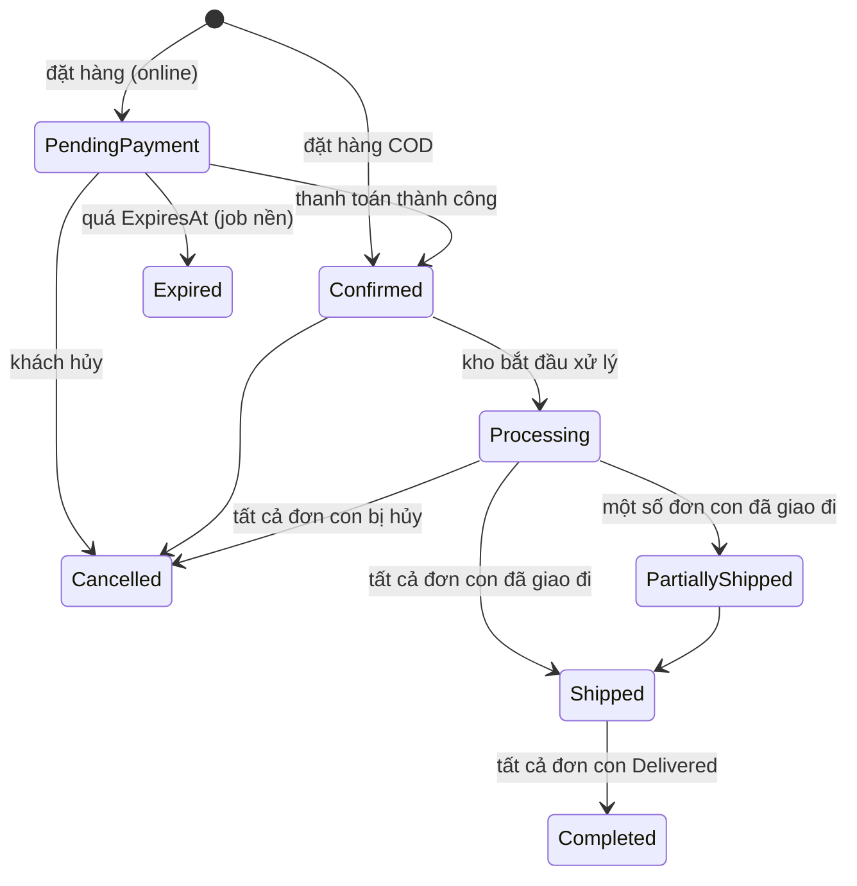

Trạng thái đơn tổng là **tổng hợp** từ các đơn con (`SellerOrders`) và do service tính lại mỗi khi đơn con đổi trạng thái.

### 5.2 Đơn con `SellerOrders.Status`

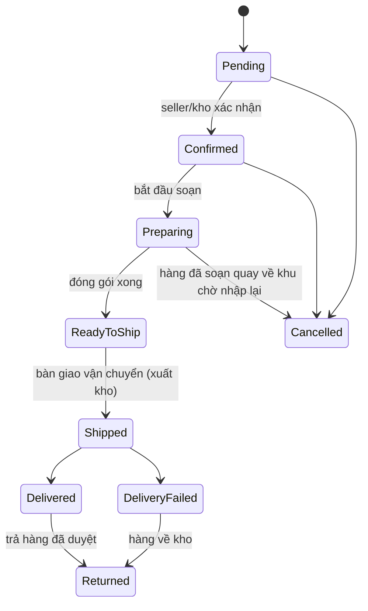

Không cho hủy tự do sau khi `Shipped`.

### 5.3 Phiếu xuất `InventoryIssues.Status`

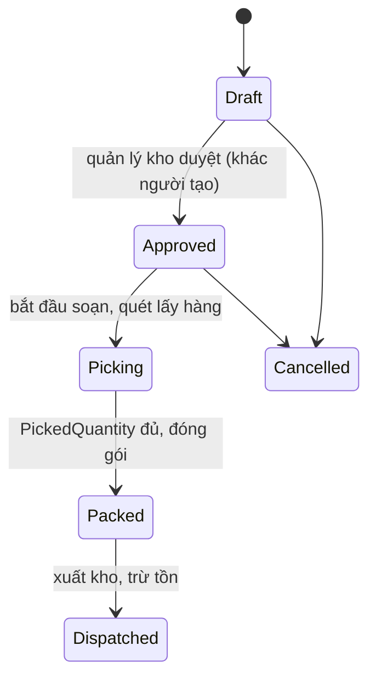

Khi `Dispatched`: trừ `OnHand` và `Reserved`, `StockReservations` → `Consumed`, ghi `StockMovements` loại `Issue`.

### 5.4 Các luồng còn lại

| Đối tượng | Cột | Luồng chính | Nhánh phụ |
|---|---|---|---|
| Seller | `Sellers.Status` | `Pending → Approved` | `Rejected`, `Suspended` |
| Sản phẩm | `Products.ProductStatus` | `Draft → PendingReview → Active` | `Rejected`, `Inactive` (ẩn bán) |
| Thanh toán | `Payments.PaymentStatus` | `Pending → Paid` | `Failed`, `PartiallyRefunded`, `Refunded` |
| Hoàn tiền | `Refunds.RefundStatus` | `Pending → Approved → Completed` | `Rejected` |
| Giữ chỗ | `StockReservations.Status` | `Active → Consumed` | `Released`, `Expired` |
| Phiếu nhập | `InventoryReceipts.Status` | `Draft → Confirmed` | `Cancelled` (chỉ khi chưa Confirmed) |
| Điều chuyển | `StockTransfers.Status` | `Draft → Approved → InTransit → Received` | `Cancelled` |
| Kiểm kê | `StockCounts.Status` | `Draft → Counting → PendingApproval → Approved` | `Cancelled` |
| Kiện hàng | `Shipments.ShippingStatus` | `Preparing → PickedUp → InTransit → Delivered` | `Failed`, `Returned` |
| Yêu cầu trả hàng | `ReturnRequests.Status` | `Requested → Approved → ItemsReceived → Inspected → Completed` | `Rejected`, `Cancelled` |
| Kết quả kiểm hàng trả | `ReturnRequestItems.InspectionResult` | `Pending → Good / MinorDefect / Damaged` | |

---

## 6. Từ điển dữ liệu

Cột **Khóa**: `PK` khóa chính, `FK→Bảng` khóa ngoại, `UQ` duy nhất (một cột). Cột **Null**: `NOT NULL`, `NULL` (cho phép rỗng) hoặc `tính` (cột sinh tự động). Ràng buộc nhiều cột và `CHECK` nằm trong mục thu gọn của từng bảng.


### 6.1 Identity & Sellers

#### `Users`

Tài khoản dùng chung cho khách hàng, người bán, nhân viên kho, quản trị.

| Cột | Kiểu | Null | Mặc định | Khóa | Mô tả |
|---|---|---|---|---|---|
| `UserId` | `BIGINT` | NOT NULL |  | PK | Tự tăng. |
| `FullName` | `VARCHAR(150)` | NOT NULL |  |  |  |
| `Email` | `VARCHAR(255)` | NOT NULL |  | UQ |  |
| `PasswordHash` | `VARCHAR(500)` | NOT NULL |  |  | Chỉ lưu hash (BCrypt/PBKDF2), không lưu mật khẩu thô. |
| `PhoneNumber` | `VARCHAR(20)` | NULL |  |  |  |
| `AvatarUrl` | `VARCHAR(1000)` | NULL |  |  |  |
| `IsActive` | `BOOLEAN` | NOT NULL | `TRUE` |  | FALSE = khóa tài khoản. |
| `CreatedAt` | `DATETIME(3)` | NOT NULL | `UTC_TIMESTAMP(3)` |  | Thời điểm tạo (UTC). |
| `UpdatedAt` | `DATETIME(3)` | NULL |  |  | Thời điểm cập nhật gần nhất (UTC); do ứng dụng gán. |

<details><summary>Ràng buộc: 1 UNIQUE · 0 FK · 0 CHECK</summary>

**UNIQUE**

- `UQ_Users_Email`: (Email)

</details>

#### `Roles`

Danh mục vai trò: Admin, Customer, Seller, WarehouseManager, WarehouseStaff, CustomerSupport...

| Cột | Kiểu | Null | Mặc định | Khóa | Mô tả |
|---|---|---|---|---|---|
| `RoleId` | `INT` | NOT NULL |  | PK | Tự tăng. |
| `RoleName` | `VARCHAR(50)` | NOT NULL |  | UQ |  |
| `Description` | `VARCHAR(255)` | NULL |  |  |  |

<details><summary>Ràng buộc: 1 UNIQUE · 0 FK · 0 CHECK</summary>

**UNIQUE**

- `UQ_Roles_RoleName`: (RoleName)

</details>

#### `UserRoles`

Một người dùng có thể giữ nhiều vai trò.

| Cột | Kiểu | Null | Mặc định | Khóa | Mô tả |
|---|---|---|---|---|---|
| `UserId` | `BIGINT` | NOT NULL |  | PK, FK→Users |  |
| `RoleId` | `INT` | NOT NULL |  | PK, FK→Roles |  |
| `AssignedAt` | `DATETIME(3)` | NOT NULL | `UTC_TIMESTAMP(3)` |  | Thời điểm gán. |

<details><summary>Ràng buộc: 0 UNIQUE · 2 FK · 0 CHECK</summary>

**Khóa ngoại**

| Tên | Cột | Tham chiếu | Hành động |
|---|---|---|---|
| `FK_UserRoles_Users` | UserId | `Users`(UserId) | ON DELETE CASCADE |
| `FK_UserRoles_Roles` | RoleId | `Roles`(RoleId) | RESTRICT |

</details>

#### `RefreshTokens`

Refresh token của JWT. Chỉ lưu hash của token; thu hồi bằng RevokedAt.

| Cột | Kiểu | Null | Mặc định | Khóa | Mô tả |
|---|---|---|---|---|---|
| `RefreshTokenId` | `BIGINT` | NOT NULL |  | PK | Tự tăng. |
| `UserId` | `BIGINT` | NOT NULL |  | FK→Users |  |
| `TokenHash` | `CHAR(64)` | NOT NULL |  | UQ | SHA-256 dạng hex |
| `ExpiresAt` | `DATETIME(3)` | NOT NULL |  |  |  |
| `CreatedAt` | `DATETIME(3)` | NOT NULL | `UTC_TIMESTAMP(3)` |  | Thời điểm tạo (UTC). |
| `CreatedByIp` | `VARCHAR(45)` | NULL |  |  |  |
| `RevokedAt` | `DATETIME(3)` | NULL |  |  |  |
| `ReplacedByHash` | `CHAR(64)` | NULL |  |  | token mới thay thế khi xoay vòng (rotation) |

<details><summary>Ràng buộc: 1 UNIQUE · 1 FK · 0 CHECK</summary>

**UNIQUE**

- `UQ_RefreshTokens_Hash`: (TokenHash)

**Khóa ngoại**

| Tên | Cột | Tham chiếu | Hành động |
|---|---|---|---|
| `FK_RefreshTokens_Users` | UserId | `Users`(UserId) | ON DELETE CASCADE |

</details>

#### `Sellers`

Hồ sơ người bán (1 tài khoản = tối đa 1 hồ sơ). Admin duyệt trước khi được bán.

| Cột | Kiểu | Null | Mặc định | Khóa | Mô tả |
|---|---|---|---|---|---|
| `SellerId` | `BIGINT` | NOT NULL |  | PK | Tự tăng. |
| `UserId` | `BIGINT` | NOT NULL |  | FK→Users, UQ |  |
| `BusinessName` | `VARCHAR(200)` | NOT NULL |  |  |  |
| `TaxCode` | `VARCHAR(20)` | NULL |  |  |  |
| `Description` | `VARCHAR(1000)` | NULL |  |  |  |
| `CommissionRate` | `DECIMAL(5,2)` | NOT NULL | `5.00` |  | % hoa hồng sàn thu trên doanh thu của seller (0-100). |
| `Status` | `VARCHAR(30)` | NOT NULL | `'Pending'` |  | Pending → Approved / Rejected; Approved → Suspended. Chỉ seller Approved mới được bán. |
| `ApprovedAt` | `DATETIME(3)` | NULL |  |  |  |
| `RejectReason` | `VARCHAR(500)` | NULL |  |  | Lý do từ chối hoặc đình chỉ hồ sơ người bán. |
| `CreatedAt` | `DATETIME(3)` | NOT NULL | `UTC_TIMESTAMP(3)` |  | Thời điểm tạo (UTC). |
| `UpdatedAt` | `DATETIME(3)` | NULL |  |  | Thời điểm cập nhật gần nhất (UTC); do ứng dụng gán. |

<details><summary>Ràng buộc: 1 UNIQUE · 1 FK · 2 CHECK</summary>

**UNIQUE**

- `UQ_Sellers_User`: (UserId)

**Khóa ngoại**

| Tên | Cột | Tham chiếu | Hành động |
|---|---|---|---|
| `FK_Sellers_Users` | UserId | `Users`(UserId) | RESTRICT |

**CHECK**

- `CK_Sellers_Status`: `Status IN ('Pending','Approved','Rejected','Suspended')`
- `CK_Sellers_Commission`: `CommissionRate BETWEEN 0 AND 100`

</details>

#### `Shops`

Gian hàng của người bán (một seller có thể mở nhiều shop).

| Cột | Kiểu | Null | Mặc định | Khóa | Mô tả |
|---|---|---|---|---|---|
| `ShopId` | `BIGINT` | NOT NULL |  | PK | Tự tăng. |
| `SellerId` | `BIGINT` | NOT NULL |  | FK→Sellers |  |
| `ShopName` | `VARCHAR(200)` | NOT NULL |  |  |  |
| `Description` | `VARCHAR(1000)` | NULL |  |  |  |
| `LogoUrl` | `VARCHAR(1000)` | NULL |  |  |  |
| `IsActive` | `BOOLEAN` | NOT NULL | `TRUE` |  | Đang hoạt động (xóa mềm). |
| `CreatedAt` | `DATETIME(3)` | NOT NULL | `UTC_TIMESTAMP(3)` |  | Thời điểm tạo (UTC). |
| `UpdatedAt` | `DATETIME(3)` | NULL |  |  | Thời điểm cập nhật gần nhất (UTC); do ứng dụng gán. |

<details><summary>Ràng buộc: 1 UNIQUE · 1 FK · 0 CHECK</summary>

**UNIQUE**

- `UQ_Shops_Seller_Name`: (SellerId, ShopName)

**Khóa ngoại**

| Tên | Cột | Tham chiếu | Hành động |
|---|---|---|---|
| `FK_Shops_Sellers` | SellerId | `Sellers`(SellerId) | RESTRICT |

</details>


### 6.2 Product Catalog

#### `Categories`

Danh mục đa cấp (tự tham chiếu qua ParentCategoryId, NULL = danh mục gốc).

| Cột | Kiểu | Null | Mặc định | Khóa | Mô tả |
|---|---|---|---|---|---|
| `CategoryId` | `BIGINT` | NOT NULL |  | PK | Tự tăng. |
| `ParentCategoryId` | `BIGINT` | NULL |  | FK→Categories |  |
| `CategoryName` | `VARCHAR(150)` | NOT NULL |  |  |  |
| `Description` | `VARCHAR(1000)` | NULL |  |  |  |
| `IsActive` | `BOOLEAN` | NOT NULL | `TRUE` |  | Đang hoạt động (xóa mềm). |

<details><summary>Ràng buộc: 1 UNIQUE · 1 FK · 0 CHECK</summary>

**UNIQUE**

- `UQ_Categories_Parent_Name`: (ParentCategoryId, CategoryName)

**Khóa ngoại**

| Tên | Cột | Tham chiếu | Hành động |
|---|---|---|---|
| `FK_Categories_Parent` | ParentCategoryId | `Categories`(CategoryId) | RESTRICT |

</details>

#### `Products`

Sản phẩm. Người bán suy ra qua Shops.SellerId (không lưu SellerId ở đây).

- Luồng: Draft -> PendingReview (seller gửi duyệt) -> Active / Rejected (admin) -> Inactive (ẩn bán).

| Cột | Kiểu | Null | Mặc định | Khóa | Mô tả |
|---|---|---|---|---|---|
| `ProductId` | `BIGINT` | NOT NULL |  | PK | Tự tăng. |
| `ShopId` | `BIGINT` | NOT NULL |  | FK→Shops | Người bán suy ra qua Shops.SellerId (không lưu SellerId ở đây để tránh mâu thuẫn). |
| `CategoryId` | `BIGINT` | NOT NULL |  | FK→Categories |  |
| `ProductName` | `VARCHAR(250)` | NOT NULL |  |  |  |
| `Description` | `TEXT` | NULL |  |  |  |
| `ProductStatus` | `VARCHAR(30)` | NOT NULL | `'Draft'` |  | Draft → PendingReview → Active / Rejected; Active ⇄ Inactive. |
| `CreatedAt` | `DATETIME(3)` | NOT NULL | `UTC_TIMESTAMP(3)` |  | Thời điểm tạo (UTC). |
| `UpdatedAt` | `DATETIME(3)` | NULL |  |  | Thời điểm cập nhật gần nhất (UTC); do ứng dụng gán. |

<details><summary>Ràng buộc: 0 UNIQUE · 2 FK · 1 CHECK</summary>

**Khóa ngoại**

| Tên | Cột | Tham chiếu | Hành động |
|---|---|---|---|
| `FK_Products_Shops` | ShopId | `Shops`(ShopId) | RESTRICT |
| `FK_Products_Categories` | CategoryId | `Categories`(CategoryId) | RESTRICT |

**CHECK**

- `CK_Products_Status`: `ProductStatus IN ('Draft','PendingReview','Active','Inactive','Rejected')`

</details>

#### `ProductVariants`

Biến thể (SKU) là đơn vị bán và đơn vị tồn kho. Giá hiện hành nằm ở đây;

- đơn hàng chỉ lưu bản chụp giá (OrderItems.UnitPrice).

| Cột | Kiểu | Null | Mặc định | Khóa | Mô tả |
|---|---|---|---|---|---|
| `VariantId` | `BIGINT` | NOT NULL |  | PK | Tự tăng. |
| `ProductId` | `BIGINT` | NOT NULL |  | FK→Products |  |
| `SKU` | `VARCHAR(80)` | NOT NULL |  | UQ | Mã hàng duy nhất toàn hệ thống; là đơn vị bán và đơn vị tồn kho. |
| `Barcode` | `VARCHAR(50)` | NULL |  | UQ | Mã vạch để quét khi nhập/soạn/đóng gói; NULL được phép lặp. |
| `VariantName` | `VARCHAR(150)` | NOT NULL |  |  |  |
| `Price` | `DECIMAL(18,2)` | NOT NULL |  |  | Giá hiện hành. Đơn hàng chỉ lưu bản chụp giá (OrderItems.UnitPrice). |
| `WeightGrams` | `INT` | NULL |  |  |  |
| `IsActive` | `BOOLEAN` | NOT NULL | `TRUE` |  | Đang hoạt động (xóa mềm). |
| `CreatedAt` | `DATETIME(3)` | NOT NULL | `UTC_TIMESTAMP(3)` |  | Thời điểm tạo (UTC). |
| `UpdatedAt` | `DATETIME(3)` | NULL |  |  | Thời điểm cập nhật gần nhất (UTC); do ứng dụng gán. |

<details><summary>Ràng buộc: 2 UNIQUE · 1 FK · 2 CHECK</summary>

**UNIQUE**

- `UQ_ProductVariants_SKU`: (SKU)
- `UQ_ProductVariants_Barcode`: (Barcode)

**Khóa ngoại**

| Tên | Cột | Tham chiếu | Hành động |
|---|---|---|---|
| `FK_Variants_Products` | ProductId | `Products`(ProductId) | RESTRICT |

**CHECK**

- `CK_Variants_Price`: `Price >= 0`
- `CK_Variants_Weight`: `WeightGrams IS NULL OR WeightGrams >= 0`

</details>

#### `ProductImages`

Album ảnh sản phẩm. Mỗi sản phẩm tối đa 1 ảnh đại diện (ràng buộc bằng cột sinh PrimaryFlag).

| Cột | Kiểu | Null | Mặc định | Khóa | Mô tả |
|---|---|---|---|---|---|
| `ImageId` | `BIGINT` | NOT NULL |  | PK | Tự tăng. |
| `ProductId` | `BIGINT` | NOT NULL |  | FK→Products |  |
| `ImageUrl` | `VARCHAR(1000)` | NOT NULL |  |  |  |
| `IsPrimary` | `BOOLEAN` | NOT NULL | `FALSE` |  |  |
| `PrimaryFlag` | `TINYINT` | tính |  |  | Cột sinh dùng cho UNIQUE: mỗi sản phẩm tối đa 1 ảnh đại diện. |
| `DisplayOrder` | `INT` | NOT NULL | `0` |  |  |

<details><summary>Ràng buộc: 1 UNIQUE · 1 FK · 1 CHECK</summary>

**UNIQUE**

- `UQ_ProductImages_OnePrimary`: (ProductId, PrimaryFlag)

**Khóa ngoại**

| Tên | Cột | Tham chiếu | Hành động |
|---|---|---|---|
| `FK_Images_Products` | ProductId | `Products`(ProductId) | RESTRICT |

**CHECK**

- `CK_Images_Order`: `DisplayOrder >= 0`

</details>


### 6.3 Customer Interactions

#### `UserAddresses`

Sổ địa chỉ giao hàng. Mỗi người dùng tối đa 1 địa chỉ mặc định (cột sinh DefaultFlag).

- Khi đặt địa chỉ mặc định mới, service phải bỏ cờ mặc định của địa chỉ cũ trong cùng transaction.

| Cột | Kiểu | Null | Mặc định | Khóa | Mô tả |
|---|---|---|---|---|---|
| `AddressId` | `BIGINT` | NOT NULL |  | PK | Tự tăng. |
| `UserId` | `BIGINT` | NOT NULL |  | FK→Users |  |
| `RecipientName` | `VARCHAR(150)` | NOT NULL |  |  |  |
| `PhoneNumber` | `VARCHAR(20)` | NOT NULL |  |  |  |
| `Province` | `VARCHAR(100)` | NOT NULL |  |  |  |
| `District` | `VARCHAR(100)` | NOT NULL |  |  |  |
| `Ward` | `VARCHAR(100)` | NOT NULL |  |  |  |
| `StreetAddress` | `VARCHAR(300)` | NOT NULL |  |  |  |
| `IsDefault` | `BOOLEAN` | NOT NULL | `FALSE` |  |  |
| `DefaultFlag` | `TINYINT` | tính |  |  | Cột sinh dùng cho UNIQUE: mỗi người dùng tối đa 1 địa chỉ mặc định. |
| `CreatedAt` | `DATETIME(3)` | NOT NULL | `UTC_TIMESTAMP(3)` |  | Thời điểm tạo (UTC). |
| `UpdatedAt` | `DATETIME(3)` | NULL |  |  | Thời điểm cập nhật gần nhất (UTC); do ứng dụng gán. |

<details><summary>Ràng buộc: 1 UNIQUE · 1 FK · 0 CHECK</summary>

**UNIQUE**

- `UQ_UserAddresses_OneDefault`: (UserId, DefaultFlag)

**Khóa ngoại**

| Tên | Cột | Tham chiếu | Hành động |
|---|---|---|---|
| `FK_Addresses_Users` | UserId | `Users`(UserId) | RESTRICT |

</details>

#### `Carts`

Giỏ hàng: mỗi khách đúng 1 giỏ. Giỏ chỉ KIỂM TRA tồn, KHÔNG giữ chỗ.

| Cột | Kiểu | Null | Mặc định | Khóa | Mô tả |
|---|---|---|---|---|---|
| `CartId` | `BIGINT` | NOT NULL |  | PK | Tự tăng. |
| `UserId` | `BIGINT` | NOT NULL |  | FK→Users, UQ |  |
| `CreatedAt` | `DATETIME(3)` | NOT NULL | `UTC_TIMESTAMP(3)` |  | Thời điểm tạo (UTC). |
| `UpdatedAt` | `DATETIME(3)` | NULL |  |  | Thời điểm cập nhật gần nhất (UTC); do ứng dụng gán. |

<details><summary>Ràng buộc: 1 UNIQUE · 1 FK · 0 CHECK</summary>

**UNIQUE**

- `UQ_Carts_User`: (UserId)

**Khóa ngoại**

| Tên | Cột | Tham chiếu | Hành động |
|---|---|---|---|
| `FK_Carts_Users` | UserId | `Users`(UserId) | RESTRICT |

</details>

#### `CartItems`

| Cột | Kiểu | Null | Mặc định | Khóa | Mô tả |
|---|---|---|---|---|---|
| `CartItemId` | `BIGINT` | NOT NULL |  | PK | Tự tăng. |
| `CartId` | `BIGINT` | NOT NULL |  | FK→Carts |  |
| `VariantId` | `BIGINT` | NOT NULL |  | FK→ProductVariants |  |
| `Quantity` | `INT` | NOT NULL |  |  |  |
| `AddedAt` | `DATETIME(3)` | NOT NULL | `UTC_TIMESTAMP(3)` |  | Thời điểm thêm. |

<details><summary>Ràng buộc: 1 UNIQUE · 2 FK · 1 CHECK</summary>

**UNIQUE**

- `UQ_CartItems_Cart_Variant`: (CartId, VariantId)

**Khóa ngoại**

| Tên | Cột | Tham chiếu | Hành động |
|---|---|---|---|
| `FK_CartItems_Carts` | CartId | `Carts`(CartId) | ON DELETE CASCADE |
| `FK_CartItems_Variants` | VariantId | `ProductVariants`(VariantId) | RESTRICT |

**CHECK**

- `CK_CartItems_Qty`: `Quantity > 0`

</details>

#### `Wishlists`

| Cột | Kiểu | Null | Mặc định | Khóa | Mô tả |
|---|---|---|---|---|---|
| `WishlistId` | `BIGINT` | NOT NULL |  | PK | Tự tăng. |
| `UserId` | `BIGINT` | NOT NULL |  | FK→Users |  |
| `WishlistName` | `VARCHAR(100)` | NOT NULL | `'Yêu thích'` |  |  |
| `CreatedAt` | `DATETIME(3)` | NOT NULL | `UTC_TIMESTAMP(3)` |  | Thời điểm tạo (UTC). |

<details><summary>Ràng buộc: 1 UNIQUE · 1 FK · 0 CHECK</summary>

**UNIQUE**

- `UQ_Wishlists_User_Name`: (UserId, WishlistName)

**Khóa ngoại**

| Tên | Cột | Tham chiếu | Hành động |
|---|---|---|---|
| `FK_Wishlists_Users` | UserId | `Users`(UserId) | RESTRICT |

</details>

#### `WishlistItems`

| Cột | Kiểu | Null | Mặc định | Khóa | Mô tả |
|---|---|---|---|---|---|
| `WishlistItemId` | `BIGINT` | NOT NULL |  | PK | Tự tăng. |
| `WishlistId` | `BIGINT` | NOT NULL |  | FK→Wishlists |  |
| `ProductId` | `BIGINT` | NOT NULL |  | FK→Products |  |
| `AddedAt` | `DATETIME(3)` | NOT NULL | `UTC_TIMESTAMP(3)` |  | Thời điểm thêm. |

<details><summary>Ràng buộc: 1 UNIQUE · 2 FK · 0 CHECK</summary>

**UNIQUE**

- `UQ_WishlistItems`: (WishlistId, ProductId)

**Khóa ngoại**

| Tên | Cột | Tham chiếu | Hành động |
|---|---|---|---|
| `FK_WishlistItems_Wishlists` | WishlistId | `Wishlists`(WishlistId) | ON DELETE CASCADE |
| `FK_WishlistItems_Products` | ProductId | `Products`(ProductId) | RESTRICT |

</details>


### 6.4 Orders & Payments

#### `Orders`

Đơn tổng của khách (một lần checkout). Địa chỉ giao là BẢN CHỤP, không phụ thuộc UserAddresses.

- ExpiresAt: hạn thanh toán với đơn online; job nền hủy đơn + nhả giữ chỗ khi quá hạn (Status = 'Expired').
- Tổng tiền phải luôn khớp: TotalAmount = Subtotal + ShippingFee - DiscountAmount.

| Cột | Kiểu | Null | Mặc định | Khóa | Mô tả |
|---|---|---|---|---|---|
| `OrderId` | `BIGINT` | NOT NULL |  | PK | Tự tăng. |
| `CustomerId` | `BIGINT` | NOT NULL |  | FK→Users |  |
| `OrderCode` | `VARCHAR(40)` | NOT NULL |  | UQ | Mã đơn hiển thị cho khách, duy nhất. |
| `RecipientName` | `VARCHAR(150)` | NOT NULL |  |  |  |
| `RecipientPhone` | `VARCHAR(20)` | NOT NULL |  |  |  |
| `ShippingProvince` | `VARCHAR(100)` | NOT NULL |  |  | Cùng các cột Shipping*/Recipient*: BẢN CHỤP địa chỉ lúc đặt, không phụ thuộc UserAddresses. |
| `ShippingDistrict` | `VARCHAR(100)` | NOT NULL |  |  |  |
| `ShippingWard` | `VARCHAR(100)` | NOT NULL |  |  |  |
| `ShippingStreetAddress` | `VARCHAR(300)` | NOT NULL |  |  |  |
| `Subtotal` | `DECIMAL(18,2)` | NOT NULL |  |  |  |
| `ShippingFee` | `DECIMAL(18,2)` | NOT NULL | `0` |  |  |
| `DiscountAmount` | `DECIMAL(18,2)` | NOT NULL | `0` |  |  |
| `TotalAmount` | `DECIMAL(18,2)` | NOT NULL |  |  | Luôn = Subtotal + ShippingFee − DiscountAmount (CK_Orders_Total). |
| `OrderStatus` | `VARCHAR(30)` | NOT NULL | `'PendingPayment'` |  | PendingPayment → Confirmed → Processing → PartiallyShipped/Shipped → Completed; nhánh Cancelled, Expired. |
| `ExpiresAt` | `DATETIME(3)` | NULL |  |  | Hạn thanh toán đơn online; job nền hủy đơn và nhả giữ chỗ khi quá hạn. |
| `CancelReason` | `VARCHAR(500)` | NULL |  |  |  |
| `CancelledAt` | `DATETIME(3)` | NULL |  |  |  |
| `Note` | `VARCHAR(500)` | NULL |  |  |  |
| `CreatedAt` | `DATETIME(3)` | NOT NULL | `UTC_TIMESTAMP(3)` |  | Thời điểm tạo (UTC). |
| `UpdatedAt` | `DATETIME(3)` | NULL |  |  | Thời điểm cập nhật gần nhất (UTC); do ứng dụng gán. |
| `RowVersion` | `TIMESTAMP(6)` | NOT NULL | `CURRENT_TIMESTAMP(6) ON UPDATE CURRENT_TIMESTAMP(6)` |  | Concurrency token cho EF Core. |

<details><summary>Ràng buộc: 1 UNIQUE · 1 FK · 5 CHECK</summary>

**UNIQUE**

- `UQ_Orders_Code`: (OrderCode)

**Khóa ngoại**

| Tên | Cột | Tham chiếu | Hành động |
|---|---|---|---|
| `FK_Orders_Customers` | CustomerId | `Users`(UserId) | RESTRICT |

**CHECK**

- `CK_Orders_Amounts`: `Subtotal >= 0 AND ShippingFee >= 0 AND DiscountAmount >= 0 AND TotalAmount >= 0`
- `CK_Orders_Total`: `TotalAmount = Subtotal + ShippingFee - DiscountAmount`
- `CK_Orders_Discount`: `DiscountAmount <= Subtotal + ShippingFee`
- `CK_Orders_Status`: `OrderStatus IN ('PendingPayment','Confirmed','Processing','PartiallyShipped','Shipped','Completed','Cancelled','Expired')`
- `CK_Orders_Cancel`: `CancelledAt IS NULL OR OrderStatus IN ('Cancelled','Expired')`

</details>

#### `SellerOrders`

Đơn con theo từng seller (đa người bán). Mỗi seller tự xử lý/ xuất kho phần của mình.

- WarehouseId: kho được phân bổ để xuất (kho sàn hoặc kho của chính seller đó); NULL cho tới khi phân bổ.

| Cột | Kiểu | Null | Mặc định | Khóa | Mô tả |
|---|---|---|---|---|---|
| `SellerOrderId` | `BIGINT` | NOT NULL |  | PK | Tự tăng. |
| `OrderId` | `BIGINT` | NOT NULL |  | FK→Orders |  |
| `SellerId` | `BIGINT` | NOT NULL |  | FK→Sellers |  |
| `WarehouseId` | `BIGINT` | NULL |  | FK→Warehouses | Kho được phân bổ để xuất (kho sàn hoặc kho của chính seller); NULL tới khi phân bổ. |
| `Subtotal` | `DECIMAL(18,2)` | NOT NULL |  |  |  |
| `Status` | `VARCHAR(30)` | NOT NULL | `'Pending'` |  | Pending → Confirmed → Preparing → ReadyToShip → Shipped → Delivered; nhánh DeliveryFailed, Cancelled, Returned. |
| `CancelReason` | `VARCHAR(500)` | NULL |  |  |  |
| `CancelledAt` | `DATETIME(3)` | NULL |  |  |  |
| `CreatedAt` | `DATETIME(3)` | NOT NULL | `UTC_TIMESTAMP(3)` |  | Thời điểm tạo (UTC). |
| `UpdatedAt` | `DATETIME(3)` | NULL |  |  | Thời điểm cập nhật gần nhất (UTC); do ứng dụng gán. |
| `RowVersion` | `TIMESTAMP(6)` | NOT NULL | `CURRENT_TIMESTAMP(6) ON UPDATE CURRENT_TIMESTAMP(6)` |  |  |

<details><summary>Ràng buộc: 1 UNIQUE · 3 FK · 3 CHECK</summary>

**UNIQUE**

- `UQ_SellerOrders_Order_Seller`: (OrderId, SellerId)

**Khóa ngoại**

| Tên | Cột | Tham chiếu | Hành động |
|---|---|---|---|
| `FK_SellerOrders_Orders` | OrderId | `Orders`(OrderId) | RESTRICT |
| `FK_SellerOrders_Sellers` | SellerId | `Sellers`(SellerId) | RESTRICT |
| `FK_SellerOrders_Warehouses` | WarehouseId | `Warehouses`(WarehouseId) | RESTRICT |

**CHECK**

- `CK_SellerOrders_Subtotal`: `Subtotal >= 0`
- `CK_SellerOrders_Status`: `Status IN ('Pending','Confirmed','Preparing','ReadyToShip','Shipped','Delivered','DeliveryFailed','Cancelled','Returned')`
- `CK_SellerOrders_Cancel`: `CancelledAt IS NULL OR Status = 'Cancelled'`

</details>

#### `OrderItems`

Dòng hàng. Lưu BẢN CHỤP tên, SKU, đơn giá tại thời điểm đặt (đổi giá sau này không ảnh hưởng đơn cũ).

| Cột | Kiểu | Null | Mặc định | Khóa | Mô tả |
|---|---|---|---|---|---|
| `OrderItemId` | `BIGINT` | NOT NULL |  | PK | Tự tăng. |
| `SellerOrderId` | `BIGINT` | NOT NULL |  | FK→SellerOrders |  |
| `VariantId` | `BIGINT` | NOT NULL |  | FK→ProductVariants |  |
| `ProductNameSnapshot` | `VARCHAR(250)` | NOT NULL |  |  | Bản chụp tên sản phẩm lúc đặt. |
| `SKUSnapshot` | `VARCHAR(80)` | NOT NULL |  |  | Bản chụp SKU lúc đặt. |
| `UnitPrice` | `DECIMAL(18,2)` | NOT NULL |  |  | Bản chụp đơn giá lúc đặt; đổi giá sau này không ảnh hưởng đơn cũ. |
| `Quantity` | `INT` | NOT NULL |  |  |  |
| `LineTotal` | `DECIMAL(18,2)` | tính |  |  | Cột sinh = UnitPrice × Quantity. |

<details><summary>Ràng buộc: 1 UNIQUE · 2 FK · 2 CHECK</summary>

**UNIQUE**

- `UQ_OrderItems_SellerOrder_Variant`: (SellerOrderId, VariantId)

**Khóa ngoại**

| Tên | Cột | Tham chiếu | Hành động |
|---|---|---|---|
| `FK_OrderItems_SellerOrders` | SellerOrderId | `SellerOrders`(SellerOrderId) | RESTRICT |
| `FK_OrderItems_Variants` | VariantId | `ProductVariants`(VariantId) | RESTRICT |

**CHECK**

- `CK_OrderItems_Price`: `UnitPrice >= 0`
- `CK_OrderItems_Qty`: `Quantity > 0`

</details>

#### `OrderStatusHistory`

Lịch sử đổi trạng thái (ai, lúc nào, vì sao). SellerOrderId NULL = đổi trạng thái đơn tổng.

- ChangedBy NULL = hệ thống/job nền (ví dụ hết hạn thanh toán).

| Cột | Kiểu | Null | Mặc định | Khóa | Mô tả |
|---|---|---|---|---|---|
| `HistoryId` | `BIGINT` | NOT NULL |  | PK | Tự tăng. |
| `OrderId` | `BIGINT` | NOT NULL |  | FK→Orders |  |
| `SellerOrderId` | `BIGINT` | NULL |  | FK→SellerOrders | NULL = đổi trạng thái đơn tổng. |
| `FromStatus` | `VARCHAR(30)` | NULL |  |  |  |
| `ToStatus` | `VARCHAR(30)` | NOT NULL |  |  |  |
| `Reason` | `VARCHAR(500)` | NULL |  |  |  |
| `ChangedBy` | `BIGINT` | NULL |  | FK→Users | NULL = hệ thống / job nền (ví dụ hết hạn thanh toán). |
| `CreatedAt` | `DATETIME(3)` | NOT NULL | `UTC_TIMESTAMP(3)` |  | Thời điểm tạo (UTC). |

<details><summary>Ràng buộc: 0 UNIQUE · 3 FK · 0 CHECK</summary>

**Khóa ngoại**

| Tên | Cột | Tham chiếu | Hành động |
|---|---|---|---|
| `FK_StatusHistory_Orders` | OrderId | `Orders`(OrderId) | RESTRICT |
| `FK_StatusHistory_SellerOrders` | SellerOrderId | `SellerOrders`(SellerOrderId) | RESTRICT |
| `FK_StatusHistory_Users` | ChangedBy | `Users`(UserId) | RESTRICT |

</details>

#### `Payments`

Giao dịch thanh toán của đơn tổng.

- UNIQUE(PaymentMethod, TransactionCode): callback cổng thanh toán gọi lại nhiều lần chỉ tạo/xử lý 1 lần (idempotent).

| Cột | Kiểu | Null | Mặc định | Khóa | Mô tả |
|---|---|---|---|---|---|
| `PaymentId` | `BIGINT` | NOT NULL |  | PK | Tự tăng. |
| `OrderId` | `BIGINT` | NOT NULL |  | FK→Orders |  |
| `PaymentMethod` | `VARCHAR(30)` | NOT NULL |  |  |  |
| `Amount` | `DECIMAL(18,2)` | NOT NULL |  |  |  |
| `PaymentStatus` | `VARCHAR(30)` | NOT NULL | `'Pending'` |  |  |
| `TransactionCode` | `VARCHAR(100)` | NULL |  |  | Cùng PaymentMethod tạo UNIQUE: callback gọi lại nhiều lần chỉ xử lý 1 lần (idempotent). NULL với COD chưa có mã. |
| `PaidAt` | `DATETIME(3)` | NULL |  |  |  |
| `CreatedAt` | `DATETIME(3)` | NOT NULL | `UTC_TIMESTAMP(3)` |  | Thời điểm tạo (UTC). |
| `UpdatedAt` | `DATETIME(3)` | NULL |  |  | Thời điểm cập nhật gần nhất (UTC); do ứng dụng gán. |

<details><summary>Ràng buộc: 1 UNIQUE · 1 FK · 4 CHECK</summary>

**UNIQUE**

- `UQ_Payments_Method_Txn`: (PaymentMethod, TransactionCode)

**Khóa ngoại**

| Tên | Cột | Tham chiếu | Hành động |
|---|---|---|---|
| `FK_Payments_Orders` | OrderId | `Orders`(OrderId) | RESTRICT |

**CHECK**

- `CK_Payments_Method`: `PaymentMethod IN ('COD','BankTransfer','EWallet','CreditCard')`
- `CK_Payments_Amount`: `Amount >= 0`
- `CK_Payments_Status`: `PaymentStatus IN ('Pending','Paid','Failed','Refunded','PartiallyRefunded')`
- `CK_Payments_PaidAt`: `PaymentStatus NOT IN ('Paid','Refunded','PartiallyRefunded') OR PaidAt IS NOT NULL`

</details>

#### `Refunds`

Hoàn tiền. Tổng hoàn không được vượt số đã thanh toán (trigger trg_Refunds_BI ở file 05).

| Cột | Kiểu | Null | Mặc định | Khóa | Mô tả |
|---|---|---|---|---|---|
| `RefundId` | `BIGINT` | NOT NULL |  | PK | Tự tăng. |
| `PaymentId` | `BIGINT` | NOT NULL |  | FK→Payments |  |
| `SellerOrderId` | `BIGINT` | NULL |  | FK→SellerOrders |  |
| `ReturnRequestId` | `BIGINT` | NULL |  | FK→ReturnRequests | Hoàn tiền phát sinh từ yêu cầu trả hàng (nếu có). |
| `Amount` | `DECIMAL(18,2)` | NOT NULL |  |  | Tổng hoàn của một Payment không được vượt số đã thanh toán (trigger trg_Refunds_BI). |
| `Reason` | `VARCHAR(500)` | NULL |  |  |  |
| `RefundStatus` | `VARCHAR(30)` | NOT NULL | `'Pending'` |  |  |
| `ApprovedBy` | `BIGINT` | NULL |  | FK→Users |  |
| `ProcessedAt` | `DATETIME(3)` | NULL |  |  |  |
| `CreatedAt` | `DATETIME(3)` | NOT NULL | `UTC_TIMESTAMP(3)` |  | Thời điểm tạo (UTC). |

<details><summary>Ràng buộc: 0 UNIQUE · 4 FK · 3 CHECK</summary>

**Khóa ngoại**

| Tên | Cột | Tham chiếu | Hành động |
|---|---|---|---|
| `FK_Refunds_Payments` | PaymentId | `Payments`(PaymentId) | RESTRICT |
| `FK_Refunds_SellerOrders` | SellerOrderId | `SellerOrders`(SellerOrderId) | RESTRICT |
| `FK_Refunds_ReturnRequests` | ReturnRequestId | `ReturnRequests`(ReturnRequestId) | RESTRICT |
| `FK_Refunds_ApprovedBy` | ApprovedBy | `Users`(UserId) | RESTRICT |

**CHECK**

- `CK_Refunds_Amount`: `Amount > 0`
- `CK_Refunds_Status`: `RefundStatus IN ('Pending','Approved','Rejected','Completed')`
- `CK_Refunds_Completed`: `RefundStatus <> 'Completed' OR ProcessedAt IS NOT NULL`

</details>


### 6.5 Warehouse & Inventory

#### `Warehouses`

Kho: 'Platform' (kho sàn, giữ hàng của nhiều seller) hoặc 'Seller' (kho riêng của 1 seller).

| Cột | Kiểu | Null | Mặc định | Khóa | Mô tả |
|---|---|---|---|---|---|
| `WarehouseId` | `BIGINT` | NOT NULL |  | PK | Tự tăng. |
| `WarehouseName` | `VARCHAR(200)` | NOT NULL |  |  |  |
| `WarehouseType` | `VARCHAR(20)` | NOT NULL |  |  | 'Platform' = kho sàn (chứa hàng nhiều seller); 'Seller' = kho riêng của 1 seller. |
| `OwnerSellerId` | `BIGINT` | NULL |  | FK→Sellers | Bắt buộc với kho Seller, phải NULL với kho Platform (CK_Warehouse_Owner). |
| `Address` | `VARCHAR(500)` | NOT NULL |  |  |  |
| `IsActive` | `BOOLEAN` | NOT NULL | `TRUE` |  | Đang hoạt động (xóa mềm). |
| `CreatedAt` | `DATETIME(3)` | NOT NULL | `UTC_TIMESTAMP(3)` |  | Thời điểm tạo (UTC). |
| `UpdatedAt` | `DATETIME(3)` | NULL |  |  | Thời điểm cập nhật gần nhất (UTC); do ứng dụng gán. |

<details><summary>Ràng buộc: 0 UNIQUE · 1 FK · 2 CHECK</summary>

**Khóa ngoại**

| Tên | Cột | Tham chiếu | Hành động |
|---|---|---|---|
| `FK_Warehouses_Sellers` | OwnerSellerId | `Sellers`(SellerId) | RESTRICT |

**CHECK**

- `CK_Warehouses_Type`: `WarehouseType IN ('Platform','Seller')`
- `CK_Warehouse_Owner`: `(WarehouseType = 'Platform' AND OwnerSellerId IS NULL) OR (WarehouseType = 'Seller' AND OwnerSellerId IS NOT NULL)`

</details>

#### `WarehouseLocations`

Vị trí lưu trữ (khu/kệ/ô). IsSellable = TRUE: hàng ở đây được tính vào tồn bán được.

- Khu đặc biệt (Inbound = chờ cất, Returns = chờ kiểm hàng hoàn, Damaged = hàng hỏng) KHÔNG bán được.
- UNIQUE(LocationId, WarehouseId) là đích của khóa ngoại kép để mọi bảng không thể ghi vị trí của kho này kèm mã kho khác.

| Cột | Kiểu | Null | Mặc định | Khóa | Mô tả |
|---|---|---|---|---|---|
| `LocationId` | `BIGINT` | NOT NULL |  | PK | Tự tăng. |
| `WarehouseId` | `BIGINT` | NOT NULL |  | FK→Warehouses |  |
| `LocationCode` | `VARCHAR(50)` | NOT NULL |  |  |  |
| `StorageType` | `VARCHAR(30)` | NOT NULL | `'Standard'` |  | Standard/Cold/Hazardous/Fragile (bán được) hoặc Inbound/Returns/Damaged (khu đặc biệt, không bán). |
| `IsSellable` | `BOOLEAN` | NOT NULL | `TRUE` |  | TRUE = hàng ở đây được tính vào tồn bán được. |
| `IsActive` | `BOOLEAN` | NOT NULL | `TRUE` |  | Đang hoạt động (xóa mềm). |

<details><summary>Ràng buộc: 2 UNIQUE · 1 FK · 2 CHECK</summary>

**UNIQUE**

- `UQ_WarehouseLocation_Code`: (WarehouseId, LocationCode)
- `UQ_WarehouseLocation_WithWarehouse`: (LocationId, WarehouseId)

**Khóa ngoại**

| Tên | Cột | Tham chiếu | Hành động |
|---|---|---|---|
| `FK_Locations_Warehouses` | WarehouseId | `Warehouses`(WarehouseId) | RESTRICT |

**CHECK**

- `CK_Locations_StorageType`: `StorageType IN ('Standard','Cold','Hazardous','Fragile','Inbound','Returns','Damaged')`
- `CK_Locations_Sellable`: `StorageType IN ('Standard','Cold','Hazardous','Fragile') OR IsSellable = FALSE`

</details>

#### `Inventory`

Tồn kho theo (vị trí, biến thể). Available = QuantityOnHand - QuantityReserved (tính khi truy vấn, không lưu).

- QuantityReserved luôn bằng tổng StockReservations 'Active' tại vị trí đó (đối chiếu bằng view vw_StockReconciliation).
- RowVersion: chống 2 request cùng giữ món cuối. Khi giữ chỗ nên dùng câu lệnh nguyên tử:

```sql
UPDATE Inventory SET QuantityReserved = QuantityReserved + @q
WHERE InventoryId = @id AND QuantityOnHand - QuantityReserved >= @q; -- kiểm tra ROW_COUNT() = 1
```

| Cột | Kiểu | Null | Mặc định | Khóa | Mô tả |
|---|---|---|---|---|---|
| `InventoryId` | `BIGINT` | NOT NULL |  | PK | Tự tăng. |
| `WarehouseId` | `BIGINT` | NOT NULL |  | FK→WarehouseLocations |  |
| `LocationId` | `BIGINT` | NOT NULL |  | FK→WarehouseLocations |  |
| `VariantId` | `BIGINT` | NOT NULL |  | FK→ProductVariants |  |
| `QuantityOnHand` | `INT` | NOT NULL | `0` |  | Tồn thực tế tại vị trí. |
| `QuantityReserved` | `INT` | NOT NULL | `0` |  | Đang giữ cho đơn chưa xuất; luôn = tổng StockReservations Active tại (vị trí, biến thể). Available = OnHand − Reserved (tính khi truy vấn). |
| `UpdatedAt` | `DATETIME(3)` | NOT NULL | `UTC_TIMESTAMP(3)` |  | Thời điểm cập nhật gần nhất (UTC); do ứng dụng gán. |
| `RowVersion` | `TIMESTAMP(6)` | NOT NULL | `CURRENT_TIMESTAMP(6) ON UPDATE CURRENT_TIMESTAMP(6)` |  | Chống 2 request cùng giữ món cuối. |

<details><summary>Ràng buộc: 1 UNIQUE · 2 FK · 1 CHECK</summary>

**UNIQUE**

- `UQ_Inventory_Location_Variant`: (LocationId, VariantId)

**Khóa ngoại**

| Tên | Cột | Tham chiếu | Hành động |
|---|---|---|---|
| `FK_Inventory_Locations` | LocationId, WarehouseId (khóa kép) | `WarehouseLocations`(LocationId, WarehouseId) | RESTRICT |
| `FK_Inventory_Variants` | VariantId | `ProductVariants`(VariantId) | RESTRICT |

**CHECK**

- `CK_Inventory_Qty`: `QuantityOnHand >= 0 AND QuantityReserved >= 0 AND QuantityReserved <= QuantityOnHand`

</details>

#### `StockReservations`

Giữ chỗ tồn kho cho từng dòng đơn hàng.

- Active : đang giữ (đơn chờ thanh toán/chờ xuất). ExpiresAt NULL = không hết hạn (ví dụ COD).
- Consumed : đã xuất kho thật. Released: hủy đơn/nhả tay. Expired: job nền nhả do quá hạn thanh toán.

| Cột | Kiểu | Null | Mặc định | Khóa | Mô tả |
|---|---|---|---|---|---|
| `ReservationId` | `BIGINT` | NOT NULL |  | PK | Tự tăng. |
| `OrderItemId` | `BIGINT` | NOT NULL |  | FK→OrderItems |  |
| `WarehouseId` | `BIGINT` | NOT NULL |  | FK→WarehouseLocations |  |
| `LocationId` | `BIGINT` | NOT NULL |  | FK→WarehouseLocations, FK→Inventory |  |
| `VariantId` | `BIGINT` | NOT NULL |  | FK→Inventory |  |
| `Quantity` | `INT` | NOT NULL |  |  |  |
| `Status` | `VARCHAR(20)` | NOT NULL | `'Active'` |  | Active (đang giữ) → Consumed (đã xuất) / Released (hủy, nhả tay) / Expired (job nền nhả do quá hạn). |
| `ExpiresAt` | `DATETIME(3)` | NULL |  |  | NULL = không hết hạn (ví dụ COD). |
| `CreatedAt` | `DATETIME(3)` | NOT NULL | `UTC_TIMESTAMP(3)` |  | Thời điểm tạo (UTC). |
| `ResolvedAt` | `DATETIME(3)` | NULL |  |  |  |

<details><summary>Ràng buộc: 0 UNIQUE · 3 FK · 3 CHECK</summary>

**Khóa ngoại**

| Tên | Cột | Tham chiếu | Hành động |
|---|---|---|---|
| `FK_Reservations_OrderItems` | OrderItemId | `OrderItems`(OrderItemId) | RESTRICT |
| `FK_Reservations_Locations` | LocationId, WarehouseId (khóa kép) | `WarehouseLocations`(LocationId, WarehouseId) | RESTRICT |
| `FK_Reservations_Inventory` | LocationId, VariantId (khóa kép) | `Inventory`(LocationId, VariantId) | RESTRICT |

**CHECK**

- `CK_Reservations_Qty`: `Quantity > 0`
- `CK_Reservations_Status`: `Status IN ('Active','Consumed','Released','Expired')`
- `CK_Reservations_Resolved`: `(Status = 'Active' AND ResolvedAt IS NULL) OR (Status <> 'Active' AND ResolvedAt IS NOT NULL)`

</details>

#### `InventoryReceipts`

Phiếu NHẬP kho (inbound).

- SellerInbound : seller gửi hàng vào kho sàn (bắt buộc có SenderSellerId)
- TransferInbound : nhận hàng điều chuyển (bắt buộc có TransferId)
- CustomerReturn : nhận hàng khách trả (bắt buộc có ReturnRequestId)
- Adjustment : nhập điều chỉnh (kiểm kê dư)
- Quy tắc: người xác nhận phải khác người tạo; phiếu đã Confirmed không được hủy (làm phiếu đảo).

| Cột | Kiểu | Null | Mặc định | Khóa | Mô tả |
|---|---|---|---|---|---|
| `ReceiptId` | `BIGINT` | NOT NULL |  | PK | Tự tăng. |
| `WarehouseId` | `BIGINT` | NOT NULL |  | FK→Warehouses |  |
| `SenderSellerId` | `BIGINT` | NULL |  | FK→Sellers |  |
| `TransferId` | `BIGINT` | NULL |  | FK→StockTransfers |  |
| `ReturnRequestId` | `BIGINT` | NULL |  | FK→ReturnRequests |  |
| `ReceiptCode` | `VARCHAR(40)` | NOT NULL |  | UQ |  |
| `ReceiptType` | `VARCHAR(30)` | NOT NULL |  |  | SellerInbound / TransferInbound / CustomerReturn / Adjustment; mỗi loại bắt buộc tham chiếu tương ứng (CK_Receipts_TypeRefs). |
| `Status` | `VARCHAR(30)` | NOT NULL | `'Draft'` |  |  |
| `Note` | `VARCHAR(500)` | NULL |  |  |  |
| `CreatedBy` | `BIGINT` | NOT NULL |  | FK→Users |  |
| `ConfirmedBy` | `BIGINT` | NULL |  | FK→Users | Phải khác CreatedBy (người tạo không tự xác nhận). |
| `CreatedAt` | `DATETIME(3)` | NOT NULL | `UTC_TIMESTAMP(3)` |  | Thời điểm tạo (UTC). |
| `ConfirmedAt` | `DATETIME(3)` | NULL |  |  |  |

<details><summary>Ràng buộc: 2 UNIQUE · 6 FK · 5 CHECK</summary>

**UNIQUE**

- `UQ_Receipts_Code`: (ReceiptCode)
- `UQ_Receipts_WithWarehouse`: (ReceiptId, WarehouseId)

**Khóa ngoại**

| Tên | Cột | Tham chiếu | Hành động |
|---|---|---|---|
| `FK_Receipts_Warehouses` | WarehouseId | `Warehouses`(WarehouseId) | RESTRICT |
| `FK_Receipts_Sellers` | SenderSellerId | `Sellers`(SellerId) | RESTRICT |
| `FK_Receipts_Transfers` | TransferId | `StockTransfers`(TransferId) | RESTRICT |
| `FK_Receipts_ReturnRequests` | ReturnRequestId | `ReturnRequests`(ReturnRequestId) | RESTRICT |
| `FK_Receipts_CreatedBy` | CreatedBy | `Users`(UserId) | RESTRICT |
| `FK_Receipts_ConfirmedBy` | ConfirmedBy | `Users`(UserId) | RESTRICT |

**CHECK**

- `CK_Receipts_Type`: `ReceiptType IN ('SellerInbound','TransferInbound','CustomerReturn','Adjustment')`
- `CK_Receipts_Status`: `Status IN ('Draft','Confirmed','Cancelled')`
- `CK_Receipts_TypeRefs`: `((ReceiptType = 'SellerInbound' AND SenderSellerId IS NOT NULL) OR (ReceiptType <> 'SellerInbound' AND SenderSellerId IS NULL)) AND ((ReceiptType = 'TransferInbound' AND TransferId IS NOT NULL) OR (ReceiptType <> 'TransferInbound' AND TransferId IS NULL)) AND ((ReceiptType = 'CustomerReturn' AND ReturnRequestId IS NOT NULL) OR (ReceiptType <> 'CustomerReturn' AND ReturnRequestId IS NULL))`
- `CK_Receipts_Confirmed`: `(Status = 'Confirmed' AND ConfirmedBy IS NOT NULL AND ConfirmedAt IS NOT NULL) OR (Status <> 'Confirmed' AND ConfirmedBy IS NULL AND ConfirmedAt IS NULL)`
- `CK_Receipts_Separation`: `ConfirmedBy IS NULL OR ConfirmedBy <> CreatedBy`

</details>

#### `ReceiptDetails`

Chi tiết phiếu nhập. WarehouseId lặp lại có chủ đích: khóa ngoại kép (file 03) đảm bảo

- vị trí cất hàng thuộc đúng kho của phiếu.

| Cột | Kiểu | Null | Mặc định | Khóa | Mô tả |
|---|---|---|---|---|---|
| `ReceiptDetailId` | `BIGINT` | NOT NULL |  | PK | Tự tăng. |
| `ReceiptId` | `BIGINT` | NOT NULL |  | FK→InventoryReceipts |  |
| `WarehouseId` | `BIGINT` | NOT NULL |  | FK→InventoryReceipts, FK→WarehouseLocations |  |
| `VariantId` | `BIGINT` | NOT NULL |  | FK→ProductVariants |  |
| `LocationId` | `BIGINT` | NOT NULL |  | FK→WarehouseLocations |  |
| `Quantity` | `INT` | NOT NULL |  |  |  |
| `UnitCost` | `DECIMAL(18,2)` | NULL |  |  |  |

<details><summary>Ràng buộc: 0 UNIQUE · 3 FK · 2 CHECK</summary>

**Khóa ngoại**

| Tên | Cột | Tham chiếu | Hành động |
|---|---|---|---|
| `FK_ReceiptDetails_Receipts` | ReceiptId, WarehouseId (khóa kép) | `InventoryReceipts`(ReceiptId, WarehouseId) | RESTRICT |
| `FK_ReceiptDetails_Locations` | LocationId, WarehouseId (khóa kép) | `WarehouseLocations`(LocationId, WarehouseId) | RESTRICT |
| `FK_ReceiptDetails_Variants` | VariantId | `ProductVariants`(VariantId) | RESTRICT |

**CHECK**

- `CK_ReceiptDetails_Qty`: `Quantity > 0`
- `CK_ReceiptDetails_Cost`: `UnitCost IS NULL OR UnitCost >= 0`

</details>

#### `InventoryIssues`

Phiếu XUẤT kho (outbound). Luồng soạn/đóng gói cho đơn hàng: Draft -> Approved -> Picking -> Packed -> Dispatched.

- OrderFulfillment : xuất cho đơn của seller (bắt buộc SellerOrderId)
- TransferOutbound : xuất điều chuyển (bắt buộc TransferId)
- Adjustment / ReturnToSeller / Disposal : điều chỉnh giảm, trả lại seller, tiêu hủy (cần người duyệt)

| Cột | Kiểu | Null | Mặc định | Khóa | Mô tả |
|---|---|---|---|---|---|
| `IssueId` | `BIGINT` | NOT NULL |  | PK | Tự tăng. |
| `WarehouseId` | `BIGINT` | NOT NULL |  | FK→Warehouses |  |
| `SellerOrderId` | `BIGINT` | NULL |  | FK→SellerOrders |  |
| `TransferId` | `BIGINT` | NULL |  | FK→StockTransfers |  |
| `IssueCode` | `VARCHAR(40)` | NOT NULL |  | UQ |  |
| `IssueType` | `VARCHAR(30)` | NOT NULL |  |  | OrderFulfillment / TransferOutbound / Adjustment / ReturnToSeller / Disposal. |
| `Status` | `VARCHAR(30)` | NOT NULL | `'Draft'` |  |  |
| `Note` | `VARCHAR(500)` | NULL |  |  |  |
| `CreatedBy` | `BIGINT` | NOT NULL |  | FK→Users |  |
| `ApprovedBy` | `BIGINT` | NULL |  | FK→Users | Phải khác CreatedBy; bắt buộc có trước khi Dispatched với loại Adjustment/ReturnToSeller/Disposal. |
| `DispatchedBy` | `BIGINT` | NULL |  | FK→Users |  |
| `CreatedAt` | `DATETIME(3)` | NOT NULL | `UTC_TIMESTAMP(3)` |  | Thời điểm tạo (UTC). |
| `ApprovedAt` | `DATETIME(3)` | NULL |  |  |  |
| `DispatchedAt` | `DATETIME(3)` | NULL |  |  |  |

<details><summary>Ràng buộc: 2 UNIQUE · 6 FK · 6 CHECK</summary>

**UNIQUE**

- `UQ_Issues_Code`: (IssueCode)
- `UQ_Issues_WithWarehouse`: (IssueId, WarehouseId)

**Khóa ngoại**

| Tên | Cột | Tham chiếu | Hành động |
|---|---|---|---|
| `FK_Issues_Warehouses` | WarehouseId | `Warehouses`(WarehouseId) | RESTRICT |
| `FK_Issues_SellerOrders` | SellerOrderId | `SellerOrders`(SellerOrderId) | RESTRICT |
| `FK_Issues_Transfers` | TransferId | `StockTransfers`(TransferId) | RESTRICT |
| `FK_Issues_CreatedBy` | CreatedBy | `Users`(UserId) | RESTRICT |
| `FK_Issues_ApprovedBy` | ApprovedBy | `Users`(UserId) | RESTRICT |
| `FK_Issues_DispatchedBy` | DispatchedBy | `Users`(UserId) | RESTRICT |

**CHECK**

- `CK_Issues_Type`: `IssueType IN ('OrderFulfillment','TransferOutbound','Adjustment','ReturnToSeller','Disposal')`
- `CK_Issues_Status`: `Status IN ('Draft','Approved','Picking','Packed','Dispatched','Cancelled')`
- `CK_Issues_TypeRefs`: `((IssueType = 'OrderFulfillment' AND SellerOrderId IS NOT NULL) OR (IssueType <> 'OrderFulfillment' AND SellerOrderId IS NULL)) AND ((IssueType = 'TransferOutbound' AND TransferId IS NOT NULL) OR (IssueType <> 'TransferOutbound' AND TransferId IS NULL))`
- `CK_Issues_Separation`: `ApprovedBy IS NULL OR ApprovedBy <> CreatedBy`
- `CK_Issues_Dispatched`: `Status <> 'Dispatched' OR (DispatchedAt IS NOT NULL AND DispatchedBy IS NOT NULL)`
- `CK_Issues_NeedApproval`: `Status <> 'Dispatched' OR IssueType IN ('OrderFulfillment','TransferOutbound') OR ApprovedBy IS NOT NULL`

</details>

#### `IssueDetails`

Chi tiết phiếu xuất. Quantity = số cần lấy, PickedQuantity = số đã quét lấy thực tế.

- ReservationId: dòng giữ chỗ được tiêu thụ khi xuất (chỉ có với OrderFulfillment).

| Cột | Kiểu | Null | Mặc định | Khóa | Mô tả |
|---|---|---|---|---|---|
| `IssueDetailId` | `BIGINT` | NOT NULL |  | PK | Tự tăng. |
| `IssueId` | `BIGINT` | NOT NULL |  | FK→InventoryIssues |  |
| `WarehouseId` | `BIGINT` | NOT NULL |  | FK→InventoryIssues, FK→WarehouseLocations |  |
| `VariantId` | `BIGINT` | NOT NULL |  | FK→ProductVariants |  |
| `LocationId` | `BIGINT` | NOT NULL |  | FK→WarehouseLocations |  |
| `Quantity` | `INT` | NOT NULL |  |  |  |
| `PickedQuantity` | `INT` | NOT NULL | `0` |  | Số đã quét lấy thực tế (0 ≤ Picked ≤ Quantity). |
| `ReservationId` | `BIGINT` | NULL |  | FK→StockReservations | Dòng giữ chỗ được tiêu thụ khi xuất (chỉ với OrderFulfillment). |

<details><summary>Ràng buộc: 0 UNIQUE · 4 FK · 2 CHECK</summary>

**Khóa ngoại**

| Tên | Cột | Tham chiếu | Hành động |
|---|---|---|---|
| `FK_IssueDetails_Issues` | IssueId, WarehouseId (khóa kép) | `InventoryIssues`(IssueId, WarehouseId) | RESTRICT |
| `FK_IssueDetails_Locations` | LocationId, WarehouseId (khóa kép) | `WarehouseLocations`(LocationId, WarehouseId) | RESTRICT |
| `FK_IssueDetails_Variants` | VariantId | `ProductVariants`(VariantId) | RESTRICT |
| `FK_IssueDetails_Reservations` | ReservationId | `StockReservations`(ReservationId) | RESTRICT |

**CHECK**

- `CK_IssueDetails_Qty`: `Quantity > 0`
- `CK_IssueDetails_Picked`: `PickedQuantity >= 0 AND PickedQuantity <= Quantity`

</details>

#### `StockTransfers`

Phiếu ĐIỀU CHUYỂN giữa hai kho: Draft -> Approved -> InTransit (xuất kho nguồn) -> Received (nhập kho đích).

| Cột | Kiểu | Null | Mặc định | Khóa | Mô tả |
|---|---|---|---|---|---|
| `TransferId` | `BIGINT` | NOT NULL |  | PK | Tự tăng. |
| `SourceWarehouseId` | `BIGINT` | NOT NULL |  | FK→Warehouses |  |
| `DestinationWarehouseId` | `BIGINT` | NOT NULL |  | FK→Warehouses |  |
| `TransferCode` | `VARCHAR(40)` | NOT NULL |  | UQ |  |
| `Status` | `VARCHAR(30)` | NOT NULL | `'Draft'` |  |  |
| `Note` | `VARCHAR(500)` | NULL |  |  |  |
| `CreatedBy` | `BIGINT` | NOT NULL |  | FK→Users |  |
| `ApprovedBy` | `BIGINT` | NULL |  | FK→Users |  |
| `ReceivedBy` | `BIGINT` | NULL |  | FK→Users |  |
| `CreatedAt` | `DATETIME(3)` | NOT NULL | `UTC_TIMESTAMP(3)` |  | Thời điểm tạo (UTC). |
| `ApprovedAt` | `DATETIME(3)` | NULL |  |  |  |
| `ShippedAt` | `DATETIME(3)` | NULL |  |  |  |
| `ReceivedAt` | `DATETIME(3)` | NULL |  |  |  |

<details><summary>Ràng buộc: 1 UNIQUE · 5 FK · 4 CHECK</summary>

**UNIQUE**

- `UQ_Transfers_Code`: (TransferCode)

**Khóa ngoại**

| Tên | Cột | Tham chiếu | Hành động |
|---|---|---|---|
| `FK_Transfers_Source` | SourceWarehouseId | `Warehouses`(WarehouseId) | RESTRICT |
| `FK_Transfers_Destination` | DestinationWarehouseId | `Warehouses`(WarehouseId) | RESTRICT |
| `FK_Transfers_CreatedBy` | CreatedBy | `Users`(UserId) | RESTRICT |
| `FK_Transfers_ApprovedBy` | ApprovedBy | `Users`(UserId) | RESTRICT |
| `FK_Transfers_ReceivedBy` | ReceivedBy | `Users`(UserId) | RESTRICT |

**CHECK**

- `CK_Transfer_Status`: `Status IN ('Draft','Approved','InTransit','Received','Cancelled')`
- `CK_Transfer_Warehouses`: `SourceWarehouseId <> DestinationWarehouseId`
- `CK_Transfer_Separation`: `ApprovedBy IS NULL OR ApprovedBy <> CreatedBy`
- `CK_Transfer_Received`: `Status <> 'Received' OR (ReceivedAt IS NOT NULL AND ReceivedBy IS NOT NULL)`

</details>

#### `StockTransferDetails`

Chi tiết điều chuyển. ReceivedQuantity ghi số thực nhận (lệch với Quantity = thất thoát khi vận chuyển).

- Vị trí nguồn/đích phải thuộc đúng kho nguồn/đích (trigger ở file 05).

| Cột | Kiểu | Null | Mặc định | Khóa | Mô tả |
|---|---|---|---|---|---|
| `TransferDetailId` | `BIGINT` | NOT NULL |  | PK | Tự tăng. |
| `TransferId` | `BIGINT` | NOT NULL |  | FK→StockTransfers |  |
| `VariantId` | `BIGINT` | NOT NULL |  | FK→ProductVariants |  |
| `SourceLocationId` | `BIGINT` | NOT NULL |  | FK→WarehouseLocations |  |
| `DestinationLocationId` | `BIGINT` | NULL |  | FK→WarehouseLocations |  |
| `Quantity` | `INT` | NOT NULL |  |  |  |
| `ReceivedQuantity` | `INT` | NULL |  |  | Số thực nhận; lệch với Quantity = thất thoát khi vận chuyển. |

<details><summary>Ràng buộc: 0 UNIQUE · 4 FK · 2 CHECK</summary>

**Khóa ngoại**

| Tên | Cột | Tham chiếu | Hành động |
|---|---|---|---|
| `FK_TransferDetails_Transfers` | TransferId | `StockTransfers`(TransferId) | RESTRICT |
| `FK_TransferDetails_Variants` | VariantId | `ProductVariants`(VariantId) | RESTRICT |
| `FK_TransferDetails_SourceLocation` | SourceLocationId | `WarehouseLocations`(LocationId) | RESTRICT |
| `FK_TransferDetails_DestinationLocation` | DestinationLocationId | `WarehouseLocations`(LocationId) | RESTRICT |

**CHECK**

- `CK_TransferDetails_Qty`: `Quantity > 0`
- `CK_TransferDetails_Received`: `ReceivedQuantity IS NULL OR (ReceivedQuantity >= 0 AND ReceivedQuantity <= Quantity)`

</details>

#### `StockCounts`

Phiếu KIỂM KÊ: Draft -> Counting -> PendingApproval -> Approved (sinh điều chỉnh tồn) / Cancelled.

| Cột | Kiểu | Null | Mặc định | Khóa | Mô tả |
|---|---|---|---|---|---|
| `StockCountId` | `BIGINT` | NOT NULL |  | PK | Tự tăng. |
| `WarehouseId` | `BIGINT` | NOT NULL |  | FK→Warehouses |  |
| `CountCode` | `VARCHAR(40)` | NOT NULL |  | UQ |  |
| `Status` | `VARCHAR(30)` | NOT NULL | `'Draft'` |  |  |
| `Note` | `VARCHAR(500)` | NULL |  |  |  |
| `CreatedBy` | `BIGINT` | NOT NULL |  | FK→Users |  |
| `ApprovedBy` | `BIGINT` | NULL |  | FK→Users |  |
| `CreatedAt` | `DATETIME(3)` | NOT NULL | `UTC_TIMESTAMP(3)` |  | Thời điểm tạo (UTC). |
| `ApprovedAt` | `DATETIME(3)` | NULL |  |  |  |

<details><summary>Ràng buộc: 2 UNIQUE · 3 FK · 3 CHECK</summary>

**UNIQUE**

- `UQ_StockCounts_Code`: (CountCode)
- `UQ_StockCounts_WithWarehouse`: (StockCountId, WarehouseId)

**Khóa ngoại**

| Tên | Cột | Tham chiếu | Hành động |
|---|---|---|---|
| `FK_StockCounts_Warehouses` | WarehouseId | `Warehouses`(WarehouseId) | RESTRICT |
| `FK_StockCounts_CreatedBy` | CreatedBy | `Users`(UserId) | RESTRICT |
| `FK_StockCounts_ApprovedBy` | ApprovedBy | `Users`(UserId) | RESTRICT |

**CHECK**

- `CK_StockCounts_Status`: `Status IN ('Draft','Counting','PendingApproval','Approved','Cancelled')`
- `CK_StockCounts_Separation`: `ApprovedBy IS NULL OR ApprovedBy <> CreatedBy`
- `CK_StockCounts_Approved`: `Status <> 'Approved' OR (ApprovedBy IS NOT NULL AND ApprovedAt IS NOT NULL)`

</details>

#### `StockCountDetails`

Chi tiết kiểm kê. SystemQuantity chụp tồn hệ thống lúc bắt đầu; Difference = đếm thực - hệ thống.

- Chênh lệch bắt buộc có lý do (Reason) khi khác 0 (kiểm tra ở service).

| Cột | Kiểu | Null | Mặc định | Khóa | Mô tả |
|---|---|---|---|---|---|
| `StockCountDetailId` | `BIGINT` | NOT NULL |  | PK | Tự tăng. |
| `StockCountId` | `BIGINT` | NOT NULL |  | FK→StockCounts |  |
| `WarehouseId` | `BIGINT` | NOT NULL |  | FK→StockCounts, FK→WarehouseLocations |  |
| `LocationId` | `BIGINT` | NOT NULL |  | FK→WarehouseLocations |  |
| `VariantId` | `BIGINT` | NOT NULL |  | FK→ProductVariants |  |
| `SystemQuantity` | `INT` | NOT NULL |  |  | Tồn hệ thống chụp lúc bắt đầu kiểm kê. |
| `CountedQuantity` | `INT` | NULL |  |  |  |
| `Difference` | `INT` | tính |  |  | Cột sinh = CountedQuantity − SystemQuantity. |
| `Reason` | `VARCHAR(500)` | NULL |  |  |  |

<details><summary>Ràng buộc: 1 UNIQUE · 3 FK · 1 CHECK</summary>

**UNIQUE**

- `UQ_StockCountDetails`: (StockCountId, LocationId, VariantId)

**Khóa ngoại**

| Tên | Cột | Tham chiếu | Hành động |
|---|---|---|---|
| `FK_StockCountDetails_Counts` | StockCountId, WarehouseId (khóa kép) | `StockCounts`(StockCountId, WarehouseId) | RESTRICT |
| `FK_StockCountDetails_Locations` | LocationId, WarehouseId (khóa kép) | `WarehouseLocations`(LocationId, WarehouseId) | RESTRICT |
| `FK_StockCountDetails_Variants` | VariantId | `ProductVariants`(VariantId) | RESTRICT |

**CHECK**

- `CK_StockCountDetails_Qty`: `SystemQuantity >= 0 AND (CountedQuantity IS NULL OR CountedQuantity >= 0)`

</details>

#### `StockMovements`

SỔ CÁI TỒN KHO (stock ledger / thẻ kho). CHỈ THÊM, không sửa/xóa (trigger chặn ở file 05).

- OnHandChange : thay đổi tồn thực tế (Receipt/Issue/TransferIn/TransferOut/Adjustment/ReturnIn/StockCount)
- ReservedChange : thay đổi tồn đang giữ (Reserve/ReleaseReserve)
- Xuất cho đơn: Issue có OnHandChange = -N và ReservedChange = -N (tiêu thụ giữ chỗ).
- OnHandAfter/ReservedAfter: tồn của (vị trí, biến thể) SAU biến động - dùng đối soát và dựng thẻ kho.
- CreatedBy NULL = hệ thống/job nền.

| Cột | Kiểu | Null | Mặc định | Khóa | Mô tả |
|---|---|---|---|---|---|
| `StockMovementId` | `BIGINT` | NOT NULL |  | PK | Tự tăng. |
| `WarehouseId` | `BIGINT` | NOT NULL |  | FK→WarehouseLocations |  |
| `LocationId` | `BIGINT` | NOT NULL |  | FK→WarehouseLocations |  |
| `VariantId` | `BIGINT` | NOT NULL |  | FK→ProductVariants |  |
| `MovementType` | `VARCHAR(30)` | NOT NULL |  |  |  |
| `OnHandChange` | `INT` | NOT NULL | `0` |  | Thay đổi tồn thực tế (+/−). |
| `ReservedChange` | `INT` | NOT NULL | `0` |  | Thay đổi tồn đang giữ (+/−). |
| `OnHandAfter` | `INT` | NOT NULL |  |  | Tồn thực tế của (vị trí, biến thể) SAU biến động. |
| `ReservedAfter` | `INT` | NOT NULL |  |  | Tồn giữ chỗ SAU biến động. |
| `ReferenceType` | `VARCHAR(30)` | NOT NULL |  |  | Loại chứng từ gốc (Receipt/Issue/Transfer/StockCount/Reservation/ReturnRequest/Manual). |
| `ReferenceId` | `BIGINT` | NOT NULL |  |  | Id chứng từ gốc; đa hình theo ReferenceType nên KHÔNG có FK. |
| `CreatedBy` | `BIGINT` | NULL |  | FK→Users | NULL = hệ thống / job nền. |
| `CreatedAt` | `DATETIME(3)` | NOT NULL | `UTC_TIMESTAMP(3)` |  | Thời điểm tạo (UTC). |
| `Note` | `VARCHAR(500)` | NULL |  |  |  |

<details><summary>Ràng buộc: 0 UNIQUE · 3 FK · 4 CHECK</summary>

**Khóa ngoại**

| Tên | Cột | Tham chiếu | Hành động |
|---|---|---|---|
| `FK_Movements_Locations` | LocationId, WarehouseId (khóa kép) | `WarehouseLocations`(LocationId, WarehouseId) | RESTRICT |
| `FK_Movements_Variants` | VariantId | `ProductVariants`(VariantId) | RESTRICT |
| `FK_Movements_CreatedBy` | CreatedBy | `Users`(UserId) | RESTRICT |

**CHECK**

- `CK_Movements_Type`: `MovementType IN ('Receipt','Issue','TransferIn','TransferOut','Adjustment','ReturnIn','StockCount','Reserve','ReleaseReserve')`
- `CK_Movements_Ref`: `ReferenceType IN ('Receipt','Issue','Transfer','StockCount','Reservation','ReturnRequest','Manual')`
- `CK_Movements_NotEmpty`: `OnHandChange <> 0 OR ReservedChange <> 0`
- `CK_Movements_After`: `OnHandAfter >= 0 AND ReservedAfter >= 0 AND ReservedAfter <= OnHandAfter`

</details>


### 6.6 Shipping, Returns & Reviews

#### `Carriers`

Danh mục đơn vị vận chuyển (GHN, GHTK, Viettel Post...).

| Cột | Kiểu | Null | Mặc định | Khóa | Mô tả |
|---|---|---|---|---|---|
| `CarrierId` | `INT` | NOT NULL |  | PK | Tự tăng. |
| `CarrierCode` | `VARCHAR(30)` | NOT NULL |  | UQ |  |
| `CarrierName` | `VARCHAR(100)` | NOT NULL |  |  |  |
| `IsActive` | `BOOLEAN` | NOT NULL | `TRUE` |  | Đang hoạt động (xóa mềm). |

<details><summary>Ràng buộc: 1 UNIQUE · 0 FK · 0 CHECK</summary>

**UNIQUE**

- `UQ_Carriers_Code`: (CarrierCode)

</details>

#### `Shipments`

Kiện hàng vận chuyển của một đơn seller (một đơn có thể tách nhiều kiện).

- CodAmount: số tiền shipper thu hộ (đơn COD), 0 nếu đã thanh toán trước.

| Cột | Kiểu | Null | Mặc định | Khóa | Mô tả |
|---|---|---|---|---|---|
| `ShipmentId` | `BIGINT` | NOT NULL |  | PK | Tự tăng. |
| `SellerOrderId` | `BIGINT` | NOT NULL |  | FK→SellerOrders |  |
| `CarrierId` | `INT` | NULL |  | FK→Carriers |  |
| `TrackingNumber` | `VARCHAR(100)` | NULL |  |  |  |
| `ShippingStatus` | `VARCHAR(30)` | NOT NULL | `'Preparing'` |  |  |
| `CodAmount` | `DECIMAL(18,2)` | NOT NULL | `0` |  | Tiền shipper thu hộ (đơn COD); 0 nếu đã thanh toán trước. |
| `FailedReason` | `VARCHAR(500)` | NULL |  |  |  |
| `ShippedAt` | `DATETIME(3)` | NULL |  |  |  |
| `DeliveredAt` | `DATETIME(3)` | NULL |  |  |  |
| `CreatedAt` | `DATETIME(3)` | NOT NULL | `UTC_TIMESTAMP(3)` |  | Thời điểm tạo (UTC). |
| `UpdatedAt` | `DATETIME(3)` | NULL |  |  | Thời điểm cập nhật gần nhất (UTC); do ứng dụng gán. |

<details><summary>Ràng buộc: 1 UNIQUE · 2 FK · 3 CHECK</summary>

**UNIQUE**

- `UQ_Shipments_Carrier_Tracking`: (CarrierId, TrackingNumber)

**Khóa ngoại**

| Tên | Cột | Tham chiếu | Hành động |
|---|---|---|---|
| `FK_Shipments_SellerOrders` | SellerOrderId | `SellerOrders`(SellerOrderId) | RESTRICT |
| `FK_Shipments_Carriers` | CarrierId | `Carriers`(CarrierId) | RESTRICT |

**CHECK**

- `CK_Shipments_Status`: `ShippingStatus IN ('Preparing','PickedUp','InTransit','Delivered','Failed','Returned')`
- `CK_Shipments_Cod`: `CodAmount >= 0`
- `CK_Shipments_Delivered`: `ShippingStatus <> 'Delivered' OR DeliveredAt IS NOT NULL`

</details>

#### `ReturnRequests`

Yêu cầu TRẢ HÀNG của khách (theo đơn seller). Hàng hoàn KHÔNG tự cộng tồn bán được:

- nhận về -> kiểm tra từng dòng (ReturnRequestItems.InspectionResult) -> mới nhập vào kệ bán hoặc khu hàng hỏng.

| Cột | Kiểu | Null | Mặc định | Khóa | Mô tả |
|---|---|---|---|---|---|
| `ReturnRequestId` | `BIGINT` | NOT NULL |  | PK | Tự tăng. |
| `RequestCode` | `VARCHAR(40)` | NOT NULL |  | UQ |  |
| `SellerOrderId` | `BIGINT` | NOT NULL |  | FK→SellerOrders |  |
| `CustomerId` | `BIGINT` | NOT NULL |  | FK→Users |  |
| `Reason` | `VARCHAR(500)` | NOT NULL |  |  |  |
| `Status` | `VARCHAR(30)` | NOT NULL | `'Requested'` |  | Requested → Approved → ItemsReceived → Inspected → Completed; nhánh Rejected, Cancelled. |
| `ReviewedBy` | `BIGINT` | NULL |  | FK→Users |  |
| `ReviewedAt` | `DATETIME(3)` | NULL |  |  |  |
| `RejectReason` | `VARCHAR(500)` | NULL |  |  |  |
| `CreatedAt` | `DATETIME(3)` | NOT NULL | `UTC_TIMESTAMP(3)` |  | Thời điểm tạo (UTC). |
| `UpdatedAt` | `DATETIME(3)` | NULL |  |  | Thời điểm cập nhật gần nhất (UTC); do ứng dụng gán. |

<details><summary>Ràng buộc: 1 UNIQUE · 3 FK · 2 CHECK</summary>

**UNIQUE**

- `UQ_ReturnRequests_Code`: (RequestCode)

**Khóa ngoại**

| Tên | Cột | Tham chiếu | Hành động |
|---|---|---|---|
| `FK_ReturnRequests_SellerOrders` | SellerOrderId | `SellerOrders`(SellerOrderId) | RESTRICT |
| `FK_ReturnRequests_Customers` | CustomerId | `Users`(UserId) | RESTRICT |
| `FK_ReturnRequests_ReviewedBy` | ReviewedBy | `Users`(UserId) | RESTRICT |

**CHECK**

- `CK_ReturnRequests_Status`: `Status IN ('Requested','Approved','Rejected','ItemsReceived','Inspected','Completed','Cancelled')`
- `CK_ReturnRequests_Rejected`: `Status <> 'Rejected' OR RejectReason IS NOT NULL`

</details>

#### `ReturnRequestItems`

Dòng hàng trả + kết quả kiểm tra tình trạng.

- Good : nguyên vẹn -> nhập kệ bán MinorDefect: lỗi nhẹ -> khu giảm giá/bán lại tùy chính sách
- Damaged : hỏng -> khu hàng hỏng Pending : chưa kiểm
- RestockLocationId: vị trí nhập lại (sau khi kiểm tra).

| Cột | Kiểu | Null | Mặc định | Khóa | Mô tả |
|---|---|---|---|---|---|
| `ReturnItemId` | `BIGINT` | NOT NULL |  | PK | Tự tăng. |
| `ReturnRequestId` | `BIGINT` | NOT NULL |  | FK→ReturnRequests |  |
| `OrderItemId` | `BIGINT` | NOT NULL |  | FK→OrderItems |  |
| `Quantity` | `INT` | NOT NULL |  |  |  |
| `InspectionResult` | `VARCHAR(20)` | NOT NULL | `'Pending'` |  | Pending / Good (nhập kệ bán) / MinorDefect (lỗi nhẹ) / Damaged (khu hàng hỏng). |
| `InspectionNote` | `VARCHAR(500)` | NULL |  |  |  |
| `InspectedBy` | `BIGINT` | NULL |  | FK→Users |  |
| `InspectedAt` | `DATETIME(3)` | NULL |  |  |  |
| `RestockLocationId` | `BIGINT` | NULL |  | FK→WarehouseLocations | Vị trí nhập lại sau khi kiểm tra. |

<details><summary>Ràng buộc: 1 UNIQUE · 4 FK · 3 CHECK</summary>

**UNIQUE**

- `UQ_ReturnRequestItems`: (ReturnRequestId, OrderItemId)

**Khóa ngoại**

| Tên | Cột | Tham chiếu | Hành động |
|---|---|---|---|
| `FK_ReturnItems_Requests` | ReturnRequestId | `ReturnRequests`(ReturnRequestId) | RESTRICT |
| `FK_ReturnItems_OrderItems` | OrderItemId | `OrderItems`(OrderItemId) | RESTRICT |
| `FK_ReturnItems_InspectedBy` | InspectedBy | `Users`(UserId) | RESTRICT |
| `FK_ReturnItems_RestockLocation` | RestockLocationId | `WarehouseLocations`(LocationId) | RESTRICT |

**CHECK**

- `CK_ReturnItems_Qty`: `Quantity > 0`
- `CK_ReturnItems_Result`: `InspectionResult IN ('Pending','Good','MinorDefect','Damaged')`
- `CK_ReturnItems_Inspected`: `(InspectionResult = 'Pending' AND InspectedBy IS NULL AND InspectedAt IS NULL) OR (InspectionResult <> 'Pending' AND InspectedBy IS NOT NULL AND InspectedAt IS NOT NULL)`

</details>

#### `Reviews`

Đánh giá sản phẩm: mỗi khách đánh giá 1 lần cho mỗi dòng hàng, chỉ khi đơn đã giao (trigger ở file 05).

| Cột | Kiểu | Null | Mặc định | Khóa | Mô tả |
|---|---|---|---|---|---|
| `ReviewId` | `BIGINT` | NOT NULL |  | PK | Tự tăng. |
| `CustomerId` | `BIGINT` | NOT NULL |  | FK→Users |  |
| `OrderItemId` | `BIGINT` | NOT NULL |  | FK→OrderItems |  |
| `Rating` | `TINYINT` | NOT NULL |  |  |  |
| `Comment` | `VARCHAR(2000)` | NULL |  |  |  |
| `IsVisible` | `BOOLEAN` | NOT NULL | `TRUE` |  | FALSE = ẩn đánh giá vi phạm. |
| `CreatedAt` | `DATETIME(3)` | NOT NULL | `UTC_TIMESTAMP(3)` |  | Thời điểm tạo (UTC). |

<details><summary>Ràng buộc: 1 UNIQUE · 2 FK · 1 CHECK</summary>

**UNIQUE**

- `UQ_Reviews_Customer_Item`: (CustomerId, OrderItemId)

**Khóa ngoại**

| Tên | Cột | Tham chiếu | Hành động |
|---|---|---|---|
| `FK_Reviews_Customers` | CustomerId | `Users`(UserId) | RESTRICT |
| `FK_Reviews_OrderItems` | OrderItemId | `OrderItems`(OrderItemId) | RESTRICT |

**CHECK**

- `CK_Reviews_Rating`: `Rating BETWEEN 1 AND 5`

</details>

---

## 7. Chỉ mục

MySQL **tự tạo chỉ mục cho mọi cột khóa ngoại**, và mọi `UNIQUE`/`PRIMARY KEY` cũng là chỉ mục tra cứu, nên bảng dưới đây chỉ liệt kê các **chỉ mục phụ** thêm vào cho truy vấn thực tế (lọc, sắp xếp, phân trang, job nền). Chỉ mục có `DESC` là chỉ mục giảm dần thật sự (MySQL 8).

| Chỉ mục | Bảng | Cột | Phục vụ |
|---|---|---|---|
| `IX_Products_Shop_Status` | `Products` | ShopId, ProductStatus | Seller Center: danh sách sản phẩm của một shop theo trạng thái (WHERE ShopId = ? AND ProductStatus = ?). |
| `IX_Products_Category_Status` | `Products` | CategoryId, ProductStatus | Storefront: duyệt sản phẩm theo ngành hàng đang bán (WHERE CategoryId = ? AND ProductStatus = 'Active'). |
| `IX_Products_Status_Created` | `Products` | ProductStatus, CreatedAt | Admin: hàng đợi duyệt sản phẩm mới nhất trước (WHERE ProductStatus = 'PendingReview' ORDER BY CreatedAt). |
| `FT_Products_Name` (FULLTEXT) | `Products` | ProductName | Tìm kiếm theo tên sản phẩm (MATCH ... AGAINST). Parser mặc định tách từ theo khoảng trắng, phù hợp tiếng Việt có dấu. |
| `IX_Variants_Product_Active` | `ProductVariants` | ProductId, IsActive | Trang chi tiết: lấy các biến thể đang bán của một sản phẩm (WHERE ProductId = ? AND IsActive = 1). |
| `IX_Images_Product_Order` | `ProductImages` | ProductId, DisplayOrder | Trang chi tiết: ảnh theo thứ tự hiển thị. |
| `IX_Orders_Customer_Created` | `Orders` | CustomerId, CreatedAt DESC | Lịch sử mua hàng của khách, đơn mới nhất trước, phân trang không phải sort lại. |
| `IX_Orders_Status_Created` | `Orders` | OrderStatus, CreatedAt DESC | Admin: lọc đơn theo trạng thái, mới nhất trước. |
| `IX_Orders_Status_Expires` | `Orders` | OrderStatus, ExpiresAt | Job nền: tìm đơn chờ thanh toán đã quá hạn để hủy và nhả giữ chỗ (WHERE OrderStatus = 'PendingPayment' AND ExpiresAt < UTC_TIMESTAMP()). |
| `IX_SellerOrders_Seller_Status_Created` | `SellerOrders` | SellerId, Status, CreatedAt DESC | Seller Center: xử lý đơn theo trạng thái, mới nhất trước. |
| `IX_SellerOrders_Warehouse_Status` | `SellerOrders` | WarehouseId, Status | Hàng đợi của kho: các đơn seller đã phân bổ về một kho và đang chờ xử lý. |
| `IX_OrderItems_Variant` | `OrderItems` | VariantId | Báo cáo bán chạy / truy ngược các đơn chứa một biến thể. |
| `IX_StatusHistory_Order_Created` | `OrderStatusHistory` | OrderId, CreatedAt | Màn hình chi tiết đơn: timeline trạng thái theo thời gian. |
| `IX_Payments_Order_Status` | `Payments` | OrderId, PaymentStatus | Tra các giao dịch của một đơn theo trạng thái (kiểm tra đã thanh toán chưa, đối soát). |
| `IX_Refunds_Status_Created` | `Refunds` | RefundStatus, CreatedAt | Đối soát hoàn tiền: các yêu cầu hoàn đang chờ xử lý. |
| `IX_Inventory_Variant_Warehouse` | `Inventory` | VariantId, WarehouseId | Kiểm tra tồn khả dụng theo biến thể trong một kho (đầu vào của việc chọn kho và giữ chỗ). |
| `IX_Reservations_Status_Expires` | `StockReservations` | Status, ExpiresAt | Job nền: nhả các giữ chỗ Active đã hết hạn (WHERE Status = 'Active' AND ExpiresAt < UTC_TIMESTAMP()). |
| `IX_Reservations_OrderItem_Status` | `StockReservations` | OrderItemId, Status | Tìm giữ chỗ của một dòng đơn hàng khi hủy/xuất. |
| `IX_Reservations_Warehouse_Variant_Status` | `StockReservations` | WarehouseId, VariantId, Status | Tổng giữ chỗ đang Active theo (kho, biến thể) - dùng đối soát và tính tồn khả dụng. |
| `IX_StockMovements_Variant_Created` | `StockMovements` | VariantId, CreatedAt DESC | Thẻ kho của một mặt hàng theo thời gian (mới nhất trước). |
| `IX_StockMovements_Warehouse_Created` | `StockMovements` | WarehouseId, CreatedAt | Nhật ký của một kho theo thời gian (báo cáo nhập-xuất-tồn theo kỳ). |
| `IX_StockMovements_Reference` | `StockMovements` | ReferenceType, ReferenceId | Truy ngược sổ cái từ chứng từ gốc (ví dụ mọi biến động của phiếu xuất #123). |
| `IX_Receipts_Warehouse_Status_Created` | `InventoryReceipts` | WarehouseId, Status, CreatedAt DESC | Danh sách phiếu theo kho + trạng thái, mới nhất trước (màn hình duyệt phiếu của quản lý kho). |
| `IX_Issues_Warehouse_Status_Created` | `InventoryIssues` | WarehouseId, Status, CreatedAt DESC |  |
| `IX_Issues_SellerOrder` | `InventoryIssues` | SellerOrderId | Phiếu xuất của một đơn seller. |
| `IX_Transfers_Source_Status` | `StockTransfers` | SourceWarehouseId, Status |  |
| `IX_Transfers_Destination_Status` | `StockTransfers` | DestinationWarehouseId, Status |  |
| `IX_Shipments_SellerOrder_Status` | `Shipments` | SellerOrderId, ShippingStatus | Kiện hàng của một đơn seller theo trạng thái vận chuyển. |
| `IX_ReturnRequests_Status_Created` | `ReturnRequests` | Status, CreatedAt | Hàng đợi xử lý trả hàng theo trạng thái. |
| `IX_ReturnRequests_Customer_Created` | `ReturnRequests` | CustomerId, CreatedAt DESC | Yêu cầu trả hàng của một khách. |
| `IX_RefreshTokens_User_Expires` | `RefreshTokens` | UserId, ExpiresAt | Dọn token hết hạn và tìm token còn hiệu lực của một người dùng. |
| `IX_Sellers_Status` | `Sellers` | Status | Seller duyệt/ngừng: lọc hồ sơ seller theo trạng thái. |

---

## 8. Trigger và View

Trigger bảo vệ các quy tắc **chéo nhiều bảng** mà `CHECK` và khóa ngoại không diễn đạt được. Lỗi báo bằng `SIGNAL SQLSTATE '45000'` (MySQL error 1644) kèm thông điệp tiếng Việt; tầng API bắt lỗi này và đổi thành phản hồi nghiệp vụ (409/422).

| Trigger | Thời điểm | Bảng | Quy tắc bảo vệ |
|---|---|---|---|
| `trg_StockMovements_BU` | BEFORE UPDATE | `StockMovements` | Sổ cái là bằng chứng kiểm toán: không cho sửa. Muốn đính chính phải ghi thêm bút toán đảo. |
| `trg_StockMovements_BD` | BEFORE DELETE | `StockMovements` | Không cho xóa dòng sổ cái. |
| `trg_Inventory_BI` | BEFORE INSERT | `Inventory` | Kho riêng của seller (Warehouses.WarehouseType = 'Seller') chỉ được chứa hàng của chính seller đó. Kho sàn (Platform) chứa hàng của nhiều seller nên không bị giới hạn. |
| `trg_SellerOrders_BI` | BEFORE INSERT | `SellerOrders` | Kho phân bổ cho đơn seller phải là kho sàn hoặc kho thuộc đúng seller của đơn. |
| `trg_SellerOrders_BU` | BEFORE UPDATE | `SellerOrders` |  |
| `trg_OrderItems_BI` | BEFORE INSERT | `OrderItems` | Dòng hàng trong đơn seller phải là sản phẩm của đúng seller đó (không lẫn hàng seller khác). |
| `trg_StockReservations_BI` | BEFORE INSERT | `StockReservations` | Giữ chỗ phải: đúng biến thể của dòng đơn, đúng kho đã phân bổ cho đơn seller, và nằm ở vị trí bán được (không giữ hàng ở khu Inbound/Returns/Damaged). (Việc có đủ tồn khả dụng do câu UPDATE nguyên tử trên Inventory + CK_Inventory_Qty bảo đảm.) |
| `trg_StockTransferDetails_BI` | BEFORE INSERT | `StockTransferDetails` | Vị trí lấy hàng phải thuộc kho nguồn; vị trí cất hàng (nếu đã có) phải thuộc kho đích. |
| `trg_StockTransferDetails_BU` | BEFORE UPDATE | `StockTransferDetails` |  |
| `trg_Refunds_BI` | BEFORE INSERT | `Refunds` | Tổng hoàn (không tính khoản bị từ chối) không được vượt số tiền đã thanh toán. Service nên khóa dòng Payments (SELECT ... FOR UPDATE) trước khi tạo hoàn tiền để tránh 2 request đồng thời cùng qua kiểm tra. |
| `trg_ReturnRequests_BI` | BEFORE INSERT | `ReturnRequests` | Yêu cầu trả hàng: chỉ cho đơn seller đã giao, và đúng khách đã đặt đơn. |
| `trg_ReturnRequestItems_BI` | BEFORE INSERT | `ReturnRequestItems` | Dòng trả hàng: phải thuộc đúng đơn seller của yêu cầu và tổng số trả không vượt số đã mua. |
| `trg_Reviews_BI` | BEFORE INSERT | `Reviews` | Đánh giá: chỉ khi đơn seller đã giao và đúng khách đã mua. |

> Các kiểm tra trong trigger (đặc biệt hoàn tiền, trả hàng) **có thể bị race** khi nhiều request đồng thời. Service cần khóa dòng cha bằng `SELECT ... FOR UPDATE` trong transaction (ví dụ khóa `Payments` trước khi tạo `Refunds`).

### Views

| View | Mục đích |
|---|---|
| `vw_VariantAvailability` | Tồn bán được theo (biến thể, kho): `OnHand`, `Reserved`, `Available`. Chỉ tính vị trí `IsSellable = 1` và `IsActive = 1`. Storefront hiển thị "Hết hàng" khi tổng `Available = 0` |
| `vw_StockReconciliation` | Đối soát từng dòng `Inventory` với (1) tổng sổ cái `StockMovements` và (2) tổng giữ chỗ `Active`. Dòng nào có `OnHand_Diff`, `ReservedLedger_Diff` hoặc `ReservedReservation_Diff` khác 0 là dữ liệu sai cần điều tra |

```sql
-- Kiểm tra toàn vẹn tồn kho (kết quả phải rỗng)
SELECT * FROM vw_StockReconciliation
WHERE OnHand_Diff <> 0 OR ReservedLedger_Diff <> 0 OR ReservedReservation_Diff <> 0;
```

---

## 9. Ví dụ luồng dữ liệu end-to-end

Tình huống: kho sàn có `Inventory` tại `A-01-01` của `SKU-A`: `OnHand = 10`, `Reserved = 0`. Khách mua 2 cái (seller S1), thanh toán COD.

**Bước 1: Đặt hàng (một transaction)**

| Việc | Bảng | Ghi chú |
|---|---|---|
| Tạo đơn tổng | `Orders` (`Confirmed` vì COD) | Lưu bản chụp địa chỉ; `TotalAmount = Subtotal + ShippingFee − DiscountAmount` |
| Tạo đơn con | `SellerOrders` (S1, `WarehouseId` = kho sàn) | Phải phân bổ kho **trước** khi giữ chỗ (trigger yêu cầu) |
| Tạo dòng hàng | `OrderItems` (snapshot tên/SKU/giá, `Quantity = 2`) | |
| Giữ chỗ | `UPDATE Inventory ... Reserved + 2 WHERE Available >= 2` | `ROW_COUNT() = 0` → báo hết hàng, rollback |
| Ghi giữ chỗ | `StockReservations` (`Active`, `ExpiresAt` NULL vì COD) | |
| Ghi sổ cái | `StockMovements`: `Reserve`, `ReservedChange +2`, `OnHandAfter 10`, `ReservedAfter 2` | `ReferenceType = 'Reservation'` |
| Ghi lịch sử | `OrderStatusHistory` | |

**Bước 2: Soạn và xuất kho**

| Việc | Bảng |
|---|---|
| Tạo phiếu xuất `OrderFulfillment` (gắn `SellerOrderId`) | `InventoryIssues`, `IssueDetails` (`ReservationId` trỏ dòng giữ chỗ) |
| Quản lý kho duyệt (khác người tạo) | `InventoryIssues.ApprovedBy` |
| Nhân viên quét lấy hàng | `IssueDetails.PickedQuantity` 0 → 2 |
| Đóng gói, rồi xuất kho (`Dispatched`) | `Inventory`: `OnHand 10 → 8`, `Reserved 2 → 0`; `StockReservations` → `Consumed`; `StockMovements`: `Issue`, `OnHandChange −2`, `ReservedChange −2`, `OnHandAfter 8`, `ReservedAfter 0` |
| Bàn giao vận chuyển | `Shipments` (hãng, mã vận đơn, `CodAmount`); `SellerOrders` → `Shipped` |

**Bước 3: Nhánh hủy / hết hạn**

- Hủy trước khi xuất: `Inventory.Reserved −2`, `StockReservations` → `Released`, `StockMovements`: `ReleaseReserve`, `ReservedChange −2`.
- Đơn online quá `Orders.ExpiresAt`: job nền làm tương tự với trạng thái `Expired`, `Orders` → `Expired`.

**Bước 4: Trả hàng**

1. Khách tạo `ReturnRequests` (chỉ khi đơn con `Delivered`) kèm `ReturnRequestItems`.
2. Được duyệt, hàng về kho, nhập bằng `InventoryReceipts` loại `CustomerReturn` vào vị trí `RETURNS-01` (không bán được).
3. Kiểm tra từng dòng, rồi chuyển hàng khỏi khu `Returns` sang kệ bán (`Good`) hoặc khu `Damaged` bằng cặp bút toán `Adjustment` (−N ở `RETURNS-01`, +N ở vị trí đích), `ReferenceType = 'ReturnRequest'`.
4. Hoàn tiền qua `Refunds` (gắn `ReturnRequestId`).

---

## 10. Quy tắc phải do tầng ứng dụng bảo đảm

Các quy tắc sau **không** (hoặc không thể) được enforce hoàn toàn bằng schema; service phải thực hiện trong transaction:

| Quy tắc | Cách bảo đảm |
|---|---|
| Thứ tự chuyển trạng thái hợp lệ | State machine trong service; ghi `OrderStatusHistory` |
| Giữ chỗ không bán quá tồn | `UPDATE` nguyên tử có điều kiện `OnHand − Reserved >= @q` + kiểm tra số dòng ảnh hưởng |
| Đồng bộ `Inventory` ↔ `StockMovements` ↔ `StockReservations` | Mọi biến động tồn đi qua **một** service duy nhất, trong cùng transaction với việc ghi sổ cái; đối soát định kỳ bằng `vw_StockReconciliation` |
| Trạng thái đơn tổng tổng hợp từ đơn con | Tính lại mỗi khi đơn con đổi trạng thái |
| Hạn giữ chỗ | Job nền (Hangfire/`BackgroundService`) quét `IX_Reservations_Status_Expires` và `IX_Orders_Status_Expires` |
| Chọn kho và vị trí khi giữ chỗ | Service phân bổ (ưu tiên kho đủ hàng cho cả đơn con, gần khách) |
| Chênh lệch kiểm kê phải có lý do | Kiểm tra `StockCountDetails.Reason` khi khác 0 |
| Chỉ một địa chỉ mặc định | Khi đặt địa chỉ mặc định mới, bỏ cờ của địa chỉ cũ trong cùng transaction |
| Chống xử lý trùng callback thanh toán | Idempotency theo `Payments.TransactionCode` (đã có `UNIQUE`) |
| Tổng hoàn tiền ≤ đã thanh toán | Trigger + khóa dòng `Payments` (`FOR UPDATE`) |
| `UpdatedAt` | Gán trong `SaveChanges` (EF Core) |
| Phân quyền theo shop/seller | Kiểm tra quyền sở hữu ở service, không chỉ ở FE |

---

## 11. Giới hạn đã biết và hướng mở rộng

| Hạng mục | Hiện trạng | Hướng xử lý |
|---|---|---|
| `StockMovements.ReferenceId` | Tham chiếu đa hình nên không có FK | Kiểm tra ở service; truy ngược qua `IX_StockMovements_Reference` |
| Chuyển vị trí nội bộ (bin-to-bin) | Chưa có chứng từ riêng; dùng cặp `Adjustment` | Thêm bảng `StockRelocations` nếu cần |
| Phiếu soạn hàng (pick list) | Chưa có; dùng `IssueDetails.PickedQuantity` | Thêm `PickLists`/`PickLines` nếu cần gom đợt (wave picking) |
| Khuyến mãi / mã giảm giá | `Orders.DiscountAmount` có nhưng chưa có `Coupons` | Thêm `Coupons`, `CouponUsages` |
| Đối soát, chi trả cho seller | Chỉ có `Sellers.CommissionRate` | Thêm `SellerPayouts`, `PayoutItems` |
| Nhà cung cấp, đơn mua hàng | Không có (seller tự gửi hàng vào kho sàn) | Thêm `Suppliers`, `PurchaseOrders` nếu sàn tự nhập hàng |
| Nhật ký kiểm toán chung | Chỉ có `OrderStatusHistory` và `StockMovements` | Thêm `AuditLogs` cho thao tác nhạy cảm khác |
| Trigger kiểm tra chéo bảng | Có thể race khi đồng thời cao | Khóa dòng cha ở service; kiểm tra lại bằng view đối soát |
| Giá theo thời điểm | `ProductVariants.Price` chỉ giữ giá hiện hành | Thêm bảng lịch sử giá nếu cần báo cáo |

---

## 12. Cài đặt và kiểm tra

### Thứ tự chạy

| File | Nội dung |
|---|---|
| `01_CreateDatabase.sql` | Tạo database `utf8mb4` |
| `02_CreateTables.sql` | Tạo bảng, khóa chính, UNIQUE, CHECK |
| `03_CreateForeignKeys.sql` | Khóa ngoại (gồm khóa kép) |
| `04_CreateIndexes.sql` | Chỉ mục phụ |
| `05_TriggersAndViews.sql` | Trigger và view (dùng `DELIMITER`, chạy bằng `mysql` client hoặc Workbench) |
| `06_SeedData.sql` | Vai trò, hãng vận chuyển, danh mục gốc, kho sàn và vị trí (chạy lại được nhiều lần) |

Dùng Docker: `docker compose up -d` tự chạy 6 file theo thứ tự tên file ở lần khởi tạo đầu. Muốn nạp lại từ đầu: `docker compose down -v` rồi `docker compose up -d`.

Không seed tài khoản người dùng trong SQL vì `PasswordHash` phải do ứng dụng sinh. Tạo Admin đầu tiên bằng code khởi động API (`Infrastructure/Data/Seed`) rồi gán vai trò `Admin` trong `UserRoles`.

### Truy vấn kiểm tra sau khi cài

```sql
USE ECommerceWarehouse;

-- 39 bảng, 2 view
SELECT table_type, COUNT(*) FROM information_schema.tables
WHERE table_schema = 'ECommerceWarehouse' GROUP BY table_type;

-- 86 khóa ngoại
SELECT COUNT(*) FROM information_schema.table_constraints
WHERE table_schema = 'ECommerceWarehouse' AND constraint_type = 'FOREIGN KEY';

-- 70 ràng buộc CHECK (cần MySQL >= 8.0.16)
SELECT COUNT(*) FROM information_schema.check_constraints
WHERE constraint_schema = 'ECommerceWarehouse';

-- 13 trigger
SELECT COUNT(*) FROM information_schema.triggers
WHERE trigger_schema = 'ECommerceWarehouse';

-- Dữ liệu gốc: 6 vai trò, 5 hãng vận chuyển, 6 danh mục, 1 kho sàn, 8 vị trí
SELECT (SELECT COUNT(*) FROM Roles), (SELECT COUNT(*) FROM Carriers),
       (SELECT COUNT(*) FROM Categories), (SELECT COUNT(*) FROM Warehouses),
       (SELECT COUNT(*) FROM WarehouseLocations);
```


### Cấu hình EF Core (Pomelo)

- Dùng **database-first**: script SQL là nguồn sự thật; viết entity và `Configurations/` khớp schema, **không dùng EF Migrations** để tạo bảng.
- `RowVersion`: `.IsRowVersion()` (kiểu `TIMESTAMP(6)`); cột sinh (`LineTotal`, `Difference`, `PrimaryFlag`, `DefaultFlag`): `.ValueGeneratedOnAddOrUpdate()` và không cho ghi.
- `UpdatedAt`: gán trong `SaveChangesAsync` (override).
- Cấu hình `Server=...;Database=ECommerceWarehouse;...;SslMode=None` cho môi trường dev Docker.
